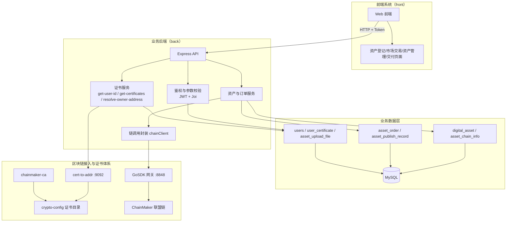
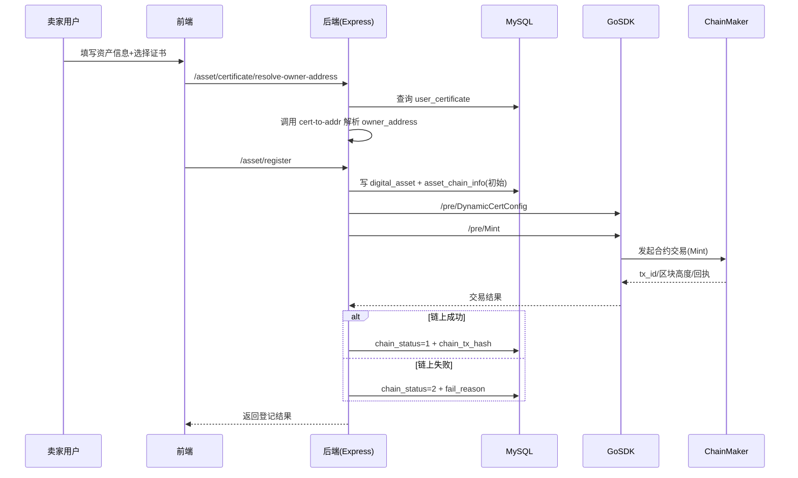
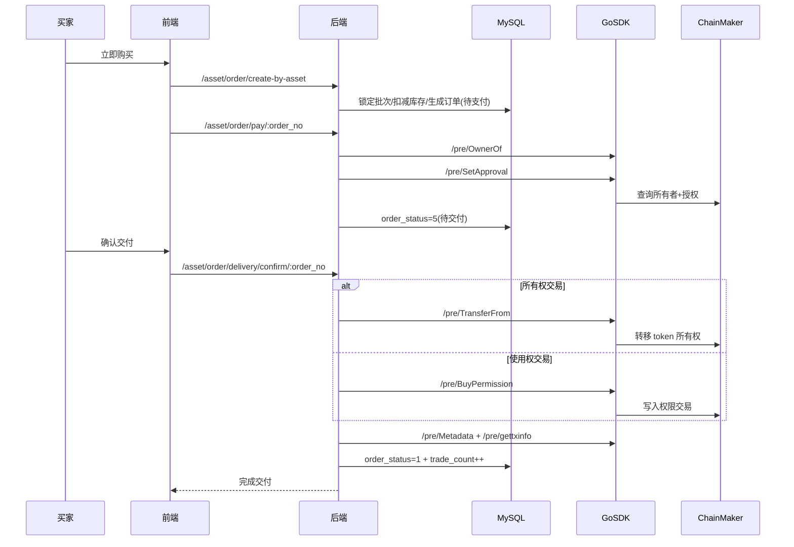

# 自动驾驶数字资产流通平台系统完整介绍（重构版）

> 版本：v2.0（基于本次对话分析重构）  
> 日期：2026-03-23  
> 覆盖仓库：`autocert`、`GoSDK`、`chainmaker-ca`

---

## 0. 本次对话结论摘要（可直接放答辩）

### 0.1 核心结论

- 本系统使用的是**联盟链（Permissioned Blockchain）**，不是公有链。
- 架构是“**业务库 + 联盟链存证/交易 + 证书身份体系**”三层协同。
- `GoSDK` 是你的链上网关/适配层，不是区块链本体，也不是 CA。
- `chainmaker-ca` 负责证书签发与证书生命周期管理。
- `autocert` 中的自动签发服务会生成 `sign/tls` 双证书，并同步到 `GoSDK/crypto-config`，供后续链上签名与安全连接。

### 0.2 你系统最重要的技术亮点

- 形成了“资产登记上链 → 市场流通 → 订单交付”的完整闭环。
- 链上关键动作（Mint、OwnerOf、SetApproval、TransferFrom、BuyPermission）可追溯。
- 通过证书身份体系，实现组织与用户维度的可信身份切换。
- 业务层保留数据库高性能能力，链上层提供不可篡改审计能力。

---

## 1. 项目目标与定位

本系统面向自动驾驶数字资产流通，目标是同时解决三类问题：

- **确权可信**：谁拥有资产、何时铸造、何时变更必须可证明。
- **交易闭环**：从上架、下单、支付到交付的流程完整可控。
- **工程可落地**：保留中心化业务系统效率，同时引入联盟链可信能力。

一句话定位：

> 这是一个“中心化业务系统 + 联盟链可信层 + 证书身份体系”的企业级混合架构。

---

## 2. 重构后的系统总体架构（按实际系统边界）

## 2.1 系统结构总图（front/back + GoSDK + 证书认证）

## 2.2 系统结构说明（非实现细节）

- **front**：负责用户交互和业务流程触发，不承担链上签名与证书解析。
- **back**：承担业务编排、状态机推进、数据库事务、链上调用入口。
- **GoSDK**：统一区块链网关，把后端业务动作映射为链上合约调用（`/pre/*`）。
- **证书认证体系**：由 `chainmaker-ca` 提供证书签发，`cert-to-addr` 解析证书地址，`crypto-config` 承载证书文件。
- **核心闭环**：前端发起 -> 后端写库与编排 -> GoSDK 上链 -> 交易回执回写数据库。

---

## 3. 为什么可以确认是“联盟链”

满足联盟链的典型特征：

- 有组织标识（如 `wx-org1.chainmaker.org`）。
- 交易通过证书身份发起，不是匿名钱包。
- 通过 CA 签发证书并控制准入。
- 节点地址、信任根证书、TLS 配置受控。
- 业务系统通过 SDK 调用特定链网络，不面向公共开放网络。

因此你的系统属于：

> **企业/行业协作型联盟链应用**。

---

## 4. “业务库 + 联盟链 + 证书体系”到底是什么意思

## 4.1 业务库（MySQL）做什么

- 存放完整业务模型和状态机：用户、资产、上架批次、订单、证书映射、上传文件。
- 提供高性能检索与分页能力（市场列表、筛选、后台管理）。
- 承担事务一致性（例如下单扣库存、支付变状态）。

## 4.2 联盟链（ChainMaker）做什么

- 存关键可信事件：铸造、授权、转移、权限购买等。
- 提供不可篡改和可追溯能力。
- 输出交易哈希/区块高度/时间戳，支持审计。

## 4.3 证书身份体系做什么

- 决定“谁有资格上链”“以谁的身份上链”。
- `tls` 证书用于双向 TLS 安全连接。
- `sign` 证书用于交易签名与身份确认。
- 地址由证书解析（`owner_address`），成为链上资产主体身份。

---

## 5. 你确认的“自动签发服务”含义（结合实际）

你当前自动签发服务的流程：

1. 调用 `chainmaker-ca` 生成用户 `sign/tls` 双证书。
2. 将证书与密钥写入约定目录。
3. 复制到 `GoSDK/crypto-config/<org>/user/<client>/`。
4. GoSDK 后续按该目录加载证书，完成链上通信和交易签名。

这一步的价值：

- 让新用户可以自动获得链上身份，不再手工发证和拷贝。
- 支持组织化管理身份和权限。
- 为后续“动态切换上链身份”打基础。

---

## 6. GoSDK 的角色与价值

`GoSDK` 的定位：**链上调用中台/网关**。

它解决了四件事：

- **接口统一**：把复杂链调用封装为 HTTP（`/pre/*`）。
- **参数适配**：把业务参数转为合约参数，处理编码（如 metadata base64）。
- **身份切换**：根据用户证书动态切换链上签名身份。
- **回执标准化**：统一返回 `tx_id`、`tx_block_height`、`tx_timestamp`、`gas_used`。

它不是：

- 不是区块链节点本体。
- 不是证书 CA 服务。
- 不是主要业务数据库。

---

## 7. `DynamicCertConfig` 是做什么的

## 7.1 定义

`DynamicCertConfig` 是“**动态身份切换接口**”，用于在交易发起前，把 SDK 当前身份切到指定组织/用户证书。

## 7.2 它实际更新的内容

- `org_id`
- `user_key_file_path`
- `user_crt_file_path`
- `user_sign_key_file_path`
- `user_sign_crt_file_path`
- 节点地址与信任根路径（按组织切换）

## 7.3 为什么必须有它

没有它，系统可能一直用默认证书发交易，导致：

- 身份不匹配（不是当前业务用户）。
- 权限校验失败。
- 审计链路不可信（链上身份与业务用户不一致）。

---

## 8. 端到端区块链逻辑（每一步有什么用）

## 8.1 资产登记上链流程

每一步的用途：

- 证书地址解析：把“证书”映射成链上身份地址。
- 先写库再上链：保证业务数据不丢，并可记录失败重试。
- 动态切证书：保证交易签名主体正确。
- 回写链状态：实现链下与链上的可追溯关联。

## 8.2 订单支付与交付流程

每一步的用途：

- `OwnerOf`：验证当前链上所有者，防止错误转移。
- `SetApproval`：链上授权，允许后续合规转移。
- `TransferFrom/BuyPermission`：把交付动作落链。
- `gettxinfo`：拿到链上证明材料，用于审计与争议处理。

---

## 9. 关键合约动作与业务语义映射

| 业务动作     | GoSDK 接口           | 链上语义             | 用途            |
| ------------ | -------------------- | -------------------- | --------------- |
| 资产铸造     | `/pre/Mint`          | Mint token           | 完成确权上链    |
| 查询所有者   | `/pre/OwnerOf`       | OwnerOf(tokenId)     | 校验当前持有人  |
| 授权         | `/pre/SetApproval`   | 授权第三方操作 token | 支付后交付准备  |
| 转移所有权   | `/pre/TransferFrom`  | token 所有权转移     | 所有权交易交付  |
| 购买使用权限 | `/pre/BuyPermission` | 记录权限交易         | 查阅/加工权交付 |
| 查询元数据   | `/pre/Metadata`      | 读取 token metadata  | 展示与核验      |
| 查交易证据   | `/pre/gettxinfo`     | 查询交易/默克尔路径  | 审计证明        |

---

## 10. 数据模型（链下主表）与链上映射

## 10.1 核心表

- `digital_asset`：资产主体信息。
- `asset_chain_info`：链上映射（token_id、owner_address、tx_hash、chain_status）。
- `asset_publish_record`：上架批次与库存。
- `asset_order`：订单状态机。
- `user_certificate`：用户证书与默认证书关系。

## 10.2 映射原则

- 业务主状态在库中推进。
- 关键动作在链上留痕。
- 交易哈希回写数据库，形成双向索引。

---

## 11. 安全与工程实践要点

## 11.1 已具备

- JWT 鉴权与接口权限控制。
- 参数校验（Joi/绑定校验）。
- 关键流程事务控制。
- 证书体系与链上身份绑定。

## 11.2 建议继续优化

- 统一敏感配置到环境变量（DB/JWT/链配置）。
- 完善链上失败重试与补偿机制。
- 增加关键流程自动化回归测试。
- 沉淀标准化部署文档与迁移脚本。

---

## 12. 常见问题（FAQ）

### Q1：为什么不把所有业务都上链？

因为链上写入成本高、查询复杂，且不适合高频复杂筛选。你现在做法（链下业务+链上凭证）是企业场景常见最优解。

### Q2：为什么要双证书（sign/tls）？

- `tls` 保障通信安全与双向认证。
- `sign` 保障交易签名身份可验证。
  两者职责不同，不建议混用。

### Q3：DynamicCertConfig 不做可以吗？

不建议。否则容易出现“业务用户 A 下单，链上却是默认用户签名”的身份错位问题。

---

## 13. 答辩可直接使用的 1 分钟总结稿

本系统面向自动驾驶数字资产流通，采用“业务数据库 + 联盟链 + 证书身份体系”的混合架构。数据库负责高效业务处理，联盟链负责关键交易与确权事实的不可篡改存证，证书体系负责身份可信和权限边界。系统已实现登记上链、市场交易、订单交付的完整闭环，并支持交易哈希回写与审计追溯。通过 GoSDK 网关，将链上调用标准化为业务接口，并通过 DynamicCertConfig 实现多组织多用户的动态身份切换，具备从演示到工程化落地的清晰路径。

---

## 14. 后续演进建议（路线图）

### 短期（1~2周）

- 完成数据库迁移脚本统一。
- 增加登记/下单/支付/交付最小回归用例。

### 中期（2~4周）

- 完善 Mint 分流策略（按行业/资产类型映射不同合约路径）。
- 把链路路由规则统一下沉到后端配置中心。

### 长期

- 引入审计看板与链上异常告警。
- 评估跨链或多链扩展能力。

---

## 附：文档使用说明

- 本文可作为：中期答辩主文档、系统设计说明、交接文档基础版本。
- 架构图、时序图为 Mermaid，可直接复制到支持 Mermaid 的 Markdown/PPT 工具中渲染。
