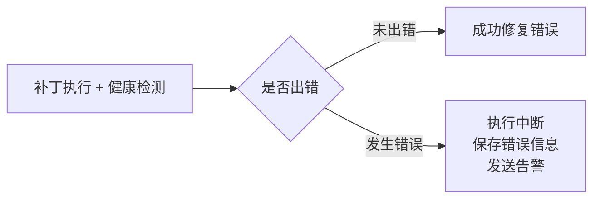

# 链上链下状态对账创新点（Reconciliation）实施说明

> 适用项目：自动驾驶数字资产流通平台（front + back + GoSDK）  
> 更新时间：2026-03-24

---

## 1. 先回答：要不要新增线程？

不需要。

当前实现使用 Node.js 的定时任务（`setInterval`）在事件循环中执行对账，不创建业务线程。  
你现在的实现已经满足“周期执行 + 非阻塞服务主线程”的要求。

---

## 2. 如何先关闭 reconcile 服务（两种方式）

## 2.1 推荐方式：用环境变量关闭（无需改代码）

在启动后端前设置：

- `RECONCILE_ENABLED=0`

原理：

- 在 `back/service/reconcile.js` 里：
  - `enabled: process.env.RECONCILE_ENABLED !== '0'`
- 该值为 `0` 时，调度器直接不启动。

## 2.2 代码方式：临时注释启动入口

在 `back/app.js` 中临时注释这行：

- `stopReconcileScheduler = startReconcileScheduler();`

这样服务仍可正常启动，但不执行周期对账。

---

## 3. 简化展示图（按你上传图片风格）

> 这张图可以直接用于答辩：先讲“自动修复分支”，再讲“失败保护分支”。

---

## 4. 这个创新点在你系统中的实现逻辑

## 4.1 对账目标

- 保证 `MySQL 状态` 与 `链上真实状态` 最终一致。
- 对账对象：
  - 资产维度：`asset_id`
  - 订单维度：`order_no`

## 4.2 任务入口（周期调度）

- 调度入口在 `back/app.js` 启动时挂载。
- 调度实现位于 `back/service/reconcile.js`。
- 默认间隔：`RECONCILE_INTERVAL_MS`（当前默认 120000ms）。

## 4.3 资产对账（asset）

- 扫描候选：`asset_chain_info.chain_status in (0,2)`。
- 链上核验：调用 `OwnerOf(tokenId)`。
- 自动修复：
  - 如果链上 owner 存在，则回写 `chain_status=1`、`owner_address`、`last_sync_time`。
  - 若失败，回写 `chain_status=2`、`retry_count+1`、`fail_reason`。

## 4.4 订单对账（order）

- 扫描候选：近 30 天且状态在 `待交付/已完成` 的订单。
- 链上核验：`OwnerOf(tokenId)` 与买方地址比对（ownership 场景）。
- 自动修复：
  - “链上已归属买方 + 库里仍待交付” -> 自动推进订单到已完成。
- 异常标记：
  - “库里已完成但链上 owner 不一致” -> 记录 warning，进入补偿/人工排查。

## 4.5 重试与退避

- 失败不立即高频重试，采用指数退避：
  - 第 n 次等待：`base * 2^n` 分钟
  - 上限由 `RECONCILE_MAX_BACKOFF_MINUTES` 控制
- 超过 `RECONCILE_MAX_RETRY` 不再自动重试，避免无限循环。

## 4.6 可观测性（答辩加分）

- 对账日志表：`reconcile_log`
- 已记录字段：
  - `biz_type`、`biz_id`
  - `expected_state`、`onchain_state`
  - `action`、`retry_count`
  - `result(success/failed/warning/skipped)`
  - `error_message`、`created_at`

---

## 5. 你可以在答辩里怎么讲

可直接用下面三句：

1. “我们不假设链上调用每次都成功，而是通过周期对账保证最终一致。”
2. “写路径优先可用性，对账路径保证正确性，系统能抗网络抖动与链节点波动。”
3. “差异可自动修复、失败可退避重试、过程可审计追踪，可靠性从一次成功升级为最终正确。”

---

## 6. 相关实现文件索引

- 调度与对账主逻辑：`back/service/reconcile.js`
- 调度挂载入口：`back/app.js`
- 对账日志建表脚本：`back/sql/reconcile_log.sql`
