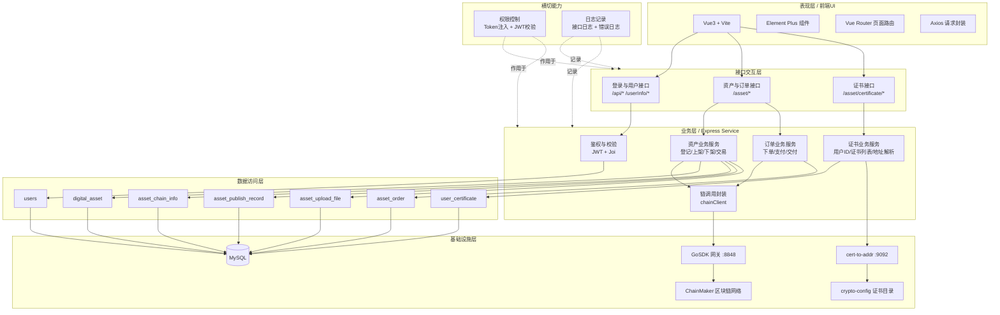
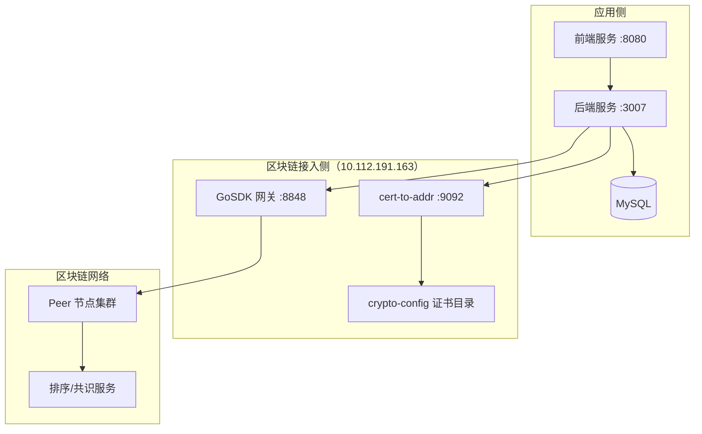
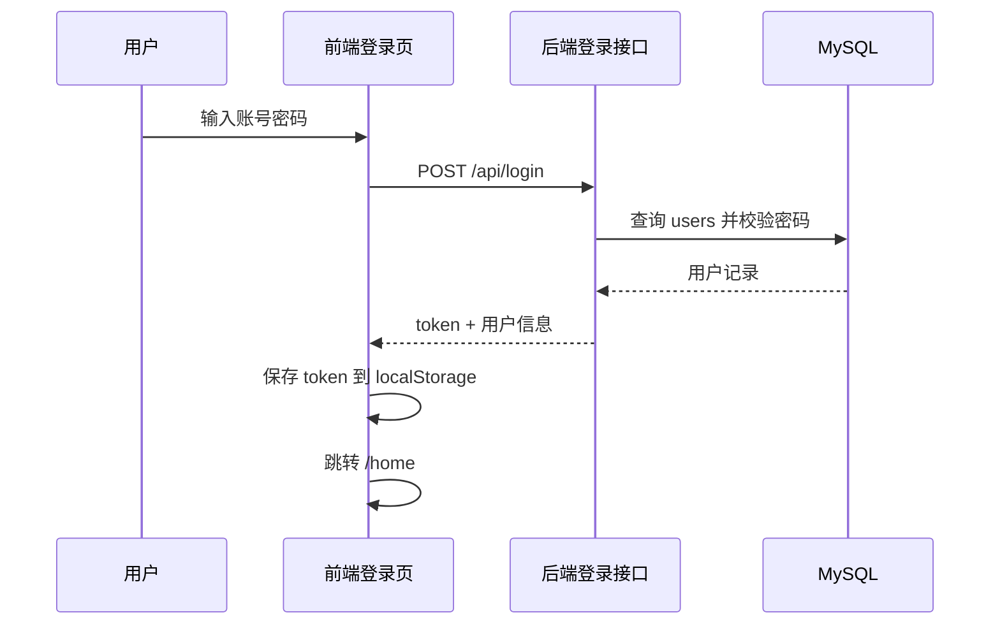
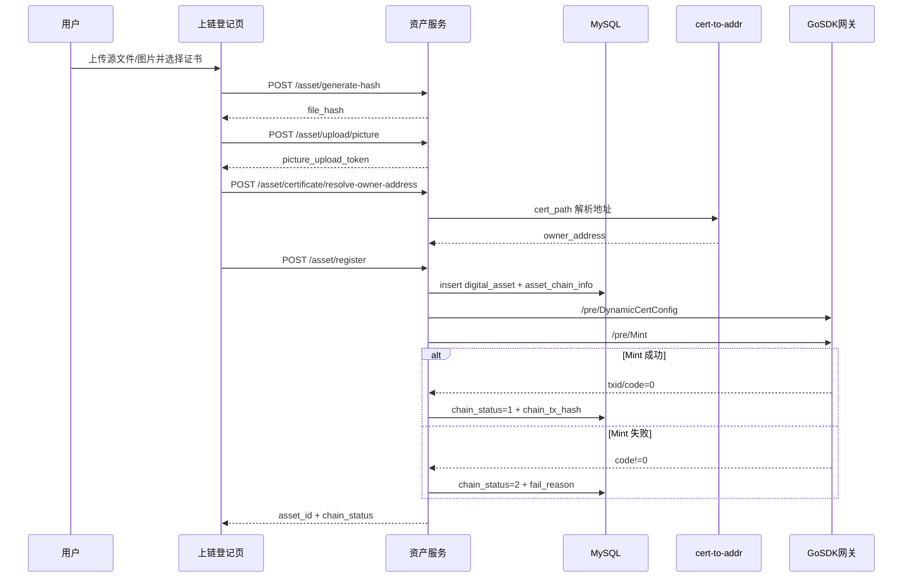
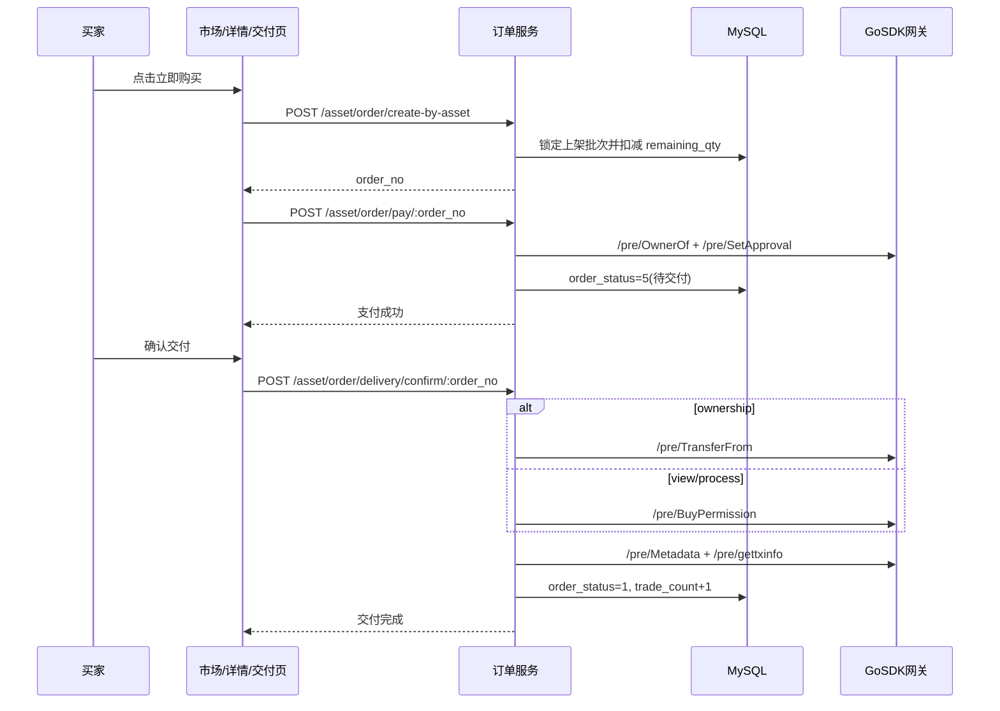
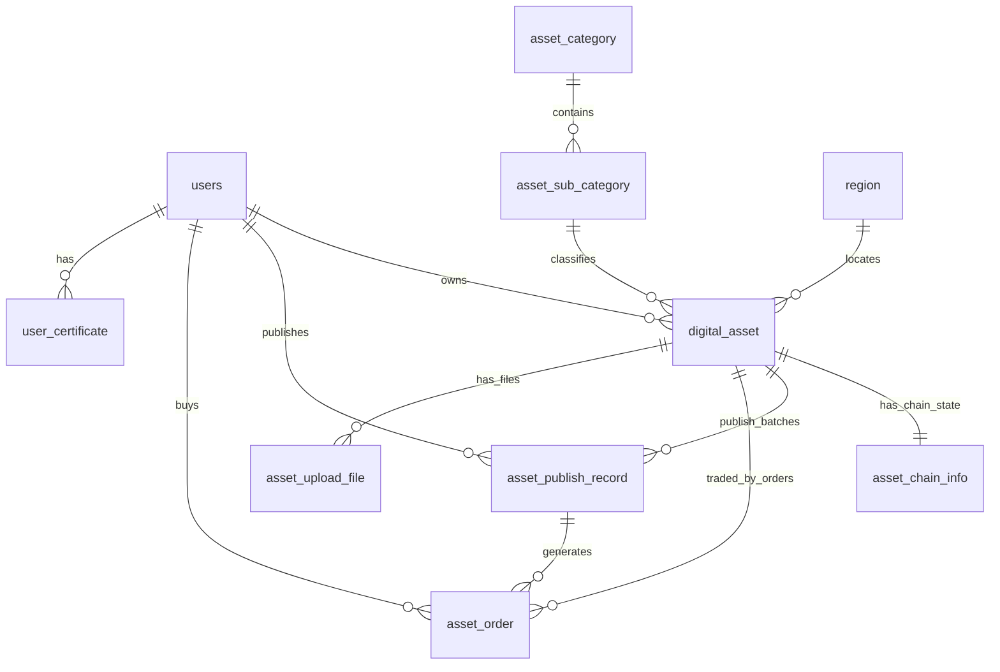

# 自动驾驶数字资产流通平台系统分析报告（中期答辩版）

> 版本：v1.0  
> 生成日期：2026-03-22  
> 依据代码仓：`front/vue-project`、`back`、`GoSDK`（含 `1015c` 参考实现）

---

## 1. 项目背景与建设目标

本系统面向“自动驾驶数字资产”的登记、交易和交付场景，目标是构建一个从**资产上链确权**到**市场流通**再到**交付结算**的闭环平台。

### 1.1 业务痛点

- 自动驾驶数据资产来源多样、确权难、交易难。
- 传统中心化系统难以证明“谁拥有资产、何时交易、交易是否完成”。
- 不同交易类型（所有权/查阅权/加工权）缺少统一业务与链上映射。

### 1.2 项目目标

- 建立统一的资产登记模型（基础信息 + 哈希 + 交易规则 + 权限规则）。
- 提供完整交易流程：上架 → 下单 → 支付 → 交付确认。
- 引入区块链能力，提升可追溯性和抗篡改能力。
- 形成可扩展的技术架构，支持后续行业映射与合约分流。

---

## 2. 系统总体介绍

系统采用前后端分离 + 区块链网关模式：

- **前端（Vue3）**：负责用户交互、表单校验、流程编排、状态展示。
- **后端（Express）**：负责鉴权、参数校验、业务编排、数据库事务控制、链上调用封装。
- **GoSDK 网关（Gin）**：对外提供 `/pre/*` 区块链接口，将 HTTP 请求映射到链上合约调用。
- **MySQL**：存储用户、资产、上架记录、订单、证书、上传文件等业务数据。

---

## 3. 技术栈与关键依赖

### 3.1 前端

- Vue 3 + Vite
- Element Plus
- Axios
- Vue Router

### 3.2 后端

- Node.js + Express
- Joi（参数校验）
- express-jwt / jsonwebtoken（JWT 鉴权）
- mysql2（数据库）
- multer（文件上传）

### 3.3 链服务

- Go + Gin（GoSDK 网关）
- ChainMaker SDK

---

## 4. 系统架构图（参考分层图重构版）

### 4.1 分层系统架构总图（详细）



### 4.2 证书获取与上链调用结构图（重点）

```mermaid
flowchart LR
  FE[前端登记页] -->|1. get-user-id| C1[/asset/certificate/get-user-id]
  FE -->|2. get-certificates| C2[/asset/certificate/get-certificates]
  FE -->|3. resolve-owner-address| C3[/asset/certificate/resolve-owner-address]

  C1 --> BE[Express 后端 :3007]
  C2 --> BE
  C3 --> BE

  BE --> UC[(user_certificate)]
  BE --> C2A[cert-to-addr :9092]
  C2A --> CFG[crypto-config/*.sign.crt]

  BE -->|owner_address + tokenId + metadata| CH[chainClient]
  CH --> GS[GoSDK :8848 /pre/*]
  GS --> CM[ChainMaker]
```

### 4.3 部署架构图（实际运行）



### 4.4 关键调用关系（对应架构图）

- 主业务链路：前端 -> 后端 -> MySQL / GoSDK -> 区块链。
- 证书获取链路：前端 -> 证书接口 -> 后端 -> `user_certificate` + `cert-to-addr`。
- 证书地址用途：`owner_address` 作为上链铸造和交易授权核心参数。
- 交易链路：下单写库，支付与交付阶段触发链上 `OwnerOf/SetApproval/TransferFrom/BuyPermission`。
- 横切能力：权限控制与日志记录覆盖接口层和业务层。

---

## 5. 模块设计说明

## 5.1 用户与权限模块

- 登录成功后下发 `businessToken`，前端保存在 localStorage。
- 前端请求拦截器自动注入 `Authorization` 头。
- 后端按路由分层：
  - `/api/*`：登录/注册等
  - `/asset/*`：业务接口（要求业务 token）
  - `/userInfo/*`：用户资料接口

## 5.2 资产登记模块

- 支持资产基础信息、分类、地区、证书、哈希、图片、交易权限配置。
- 后端登记采用事务：
  1. 插入 `digital_asset`
  2. 绑定上传文件记录
  3. 初始化 `asset_chain_info`
  4. 调用链上 Mint
  5. 回写链状态（成功/失败）

## 5.3 资产市场模块

- 支持关键字、地区、类别筛选。
- 仅展示“有可售上架批次且库存>0”的资产。
- 支持直接下单（从资产维度自动选择可用上架批次）。

## 5.4 资产管理模块

- 展示当前用户资产列表。
- 支持编辑、上架、下架。
- 下架时可回收在售剩余库存并同步关闭发布记录。

## 5.5 订单与交付模块

- 下单后订单状态 `0=待支付`。
- 支付成功后置为 `5=待交付`。
- 买家确认交付：
  - 所有权交易：`TransferFrom`
  - 使用权交易（查阅/加工）：`BuyPermission`
- 完成后状态 `1=已完成`，并累计资产 `trade_count`。

---

## 6. 核心业务时序图

## 6.1 登录认证流程



## 6.2 资产登记上链流程



## 6.3 交易交付流程



---

## 7. 数据库设计

> 说明：当前仓库中“运行 SQL 与文档草案并存”，存在字段命名迭代差异。以下模型按当前后端服务实际查询/写入行为整理。

## 7.1 关键表说明

### `users`

- 用户主表：账号、密码、身份、状态、昵称、性别、邮箱、头像等。

### `digital_asset`

- 资产主表：
  - 基础：`asset_name`, `brief`, `description`, `security_level`
  - 分类：`category_id`, `sub_category_id`, `region_id`
  - 文件：`file_hash`, `hash_algorithm`, `cover_image_url`, `file_size`, `file_format`
  - 交易：`price`, `price_unit`, `total_qty`, `available_qty`, `is_divisible`
  - 权限：`can_sell_ownership`, `can_sell_view_right`, `can_sell_process_right`
  - 状态：`status`, `view_count`, `trade_count`
  - 归属：`user_id`, `certificate_name`

### `asset_chain_info`

- 链上状态表：`asset_id`, `token_id`, `owner_address`, `chain_tx_hash`, `chain_status`, `fail_reason`, `retry_count`。

### `asset_publish_record`

- 上架批次表：`asset_id`, `publisher_id`, `publish_price`, `publish_qty`, `remaining_qty`, `publish_status`。

### `asset_order`

- 订单表：`order_no`, `publish_id`, `asset_id`, `buyer_id`, `buy_qty`, `deal_price`, `order_status`。

### `asset_upload_file`

- 上传文件表：记录源文件/图片上传令牌、路径、hash、mime、大小。

### `user_certificate`

- 用户证书表：`user_id`, `org_code`, `cert_name`, `chain_address`, `is_default`, `status`。

### `asset_category` / `asset_sub_category` / `region`

- 资产分类与地区基础字典表。

## 7.2 数据库 ER 图



---

## 8. 区块链集成与关键问题分析

## 8.1 当前集成方式

- 后端通过 `chainClient` 统一调用 GoSDK 网关：
  - Mint/OwnerOf/SetApproval/TransferFrom/BuyPermission/Metadata/gettxinfo
- 证书地址通过 `cert-to-addr` 服务解析。
- 资产链状态通过 `asset_chain_info` 回写。

## 8.2 “WH 成功、非 WH 失败”问题分析

### 代码现状

- 当前业务后端登记上链固定调用 `/pre/Mint`（不可分割 NFT 路径）。
- `1015c` 中存在按行业分流：
  - `WH` 走 `Mint`
  - 非 `WH` 可走 `En-Mint`

### 根因判断

- `Mint` 与 `En-Mint` 所属合约、参数模型不同：
  - `Mint`: `to/tokenId/categoryName/metadata`
  - `En-Mint`: `from/amount`
- 当行业映射为可分割场景但仍走 `Mint`，容易触发合约校验异常（如 `code:4`）。

### 建议

- 在后端引入链路分流策略（按行业/资产类型明确 Mint 路径）。
- 将分流逻辑从前端迁移到后端，避免前后端规则不一致。

---

## 9. 接口与状态机设计

## 9.1 资产状态

- `0`: 未上架
- `1`: 上架中
- `2`: 已售罄

## 9.2 订单状态

- `0`: 待支付
- `5`: 待交付
- `1`: 已完成
- `2/3/4`: 取消/退款中/已退款（预留）

## 9.3 关键 API（摘要）

- 资产：
  - `POST /asset/register`
  - `POST /asset/generate-hash`
  - `GET /asset/list`
  - `GET /asset/detail/:id`
  - `POST /asset/publish`
- 订单：
  - `POST /asset/order/create-by-asset`
  - `POST /asset/order/pay/:order_no`
  - `POST /asset/order/delivery/confirm/:order_no`
  - `GET /asset/order/list`
- 证书：
  - `POST /asset/certificate/get-user-id`
  - `POST /asset/certificate/get-certificates`
  - `POST /asset/certificate/resolve-owner-address`

---

## 10. 安全与工程化评估

## 10.1 已具备能力

- JWT 鉴权链路可用。
- 请求参数有 Joi 校验。
- 关键交易流程使用数据库事务，避免部分写入。

## 10.2 风险点

- 数据库连接与 JWT 密钥存在硬编码。
- 数据库脚本沉淀不完整，表结构文档与实际运行可能偏移。
- 自动化测试体系缺失，回归依赖人工。

---

## 11. 当前成果与阶段结论

- 已形成“登记上链—市场交易—订单交付”的完整业务闭环。
- 已实现链上状态回写与失败原因追踪。
- 已实现不可分割资产交易约束（购买数量=1）与交易权限控制。
- 具备中期答辩所需的系统性成果展示基础。

---

## 12. 下一阶段计划（建议用于答辩汇报）

### 12.1 短期（1~2 周）

- 统一数据库迁移脚本（与服务层字段对齐）。
- 增加基础回归用例：登记、上架、下单、支付、交付。

### 12.2 中期（2~4 周）

- 实现后端链路分流：Mint / En-Mint / Tr-Mint。
- 将行业映射规则中心化配置，避免前后端分散维护。
- 引入环境变量管理敏感配置（DB/JWT/链网关地址）。

### 12.3 长期

- 支持更细粒度的权限交易策略。
- 引入审计看板与交易异常告警。
- 推进多链或跨链扩展能力。

---

## 附录 A：答辩 1 分钟总结稿

本系统面向自动驾驶数字资产流通，构建了从资产登记、上链确权、市场交易到交付确认的完整闭环。技术上采用 Vue3 + Express + MySQL + GoSDK 的分层架构，既能满足业务快速开发，也能接入链上可信能力。当前系统已实现核心交易链路和链上状态回写，并具备基础权限控制与库存状态机。下一阶段重点将放在数据库规范化、链路分流策略完善和工程安全硬化，推动系统从“可演示”向“可稳定部署”演进。

---

## 附录 B：可直接复制到 PPT 的页面建议

1. 课题背景与目标
2. 系统总体架构（架构图）
3. 功能模块划分
4. 资产登记上链时序图
5. 交易交付时序图
6. 数据库设计与 ER 图
7. 区块链集成方案
8. 关键问题与解决策略（WH/非WH）
9. 当前成果与演示截图
10. 下一阶段计划与里程碑
