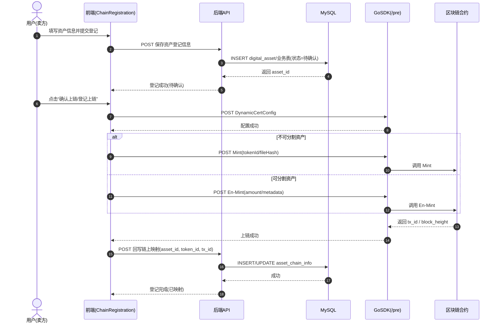
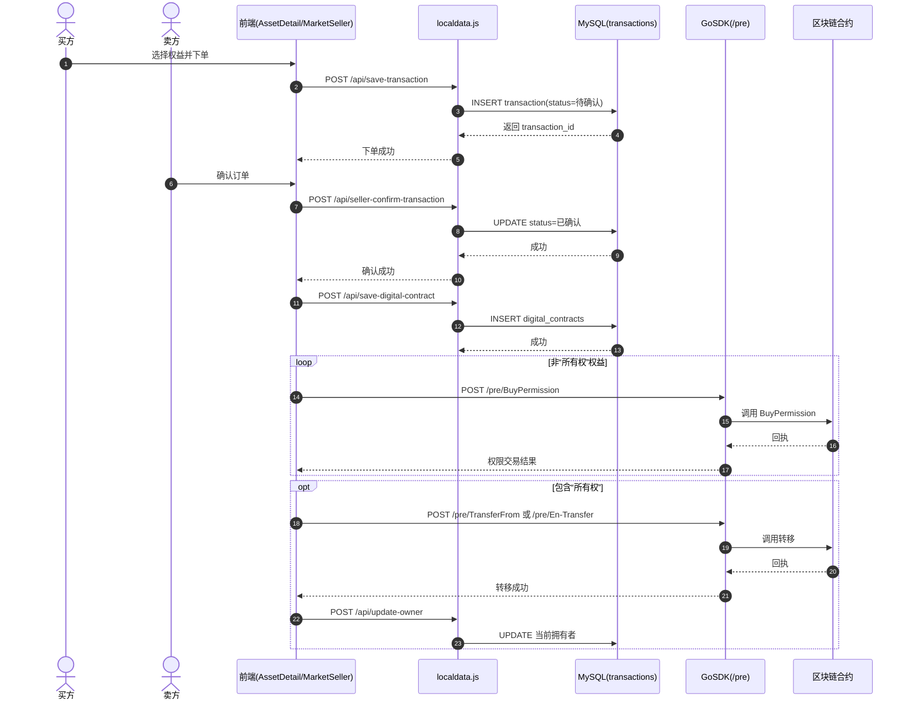

User: 我的front和back是我的基于区块链的自动驾驶数字资产流通平台，该平台参照1015c和localdata.js进行实现，调用的区块链相关的代码运行在服务器上，现在接口已经完成，不要修改，现在请修改一下前端后端，上传数字资产的时候不上传数字资产封面,按照资产类型，直接使用vue-project/src/assets/img/asset-cover中的图片，修改资产登记、资产市场、资产详细界面 的图片，其他部分保持不变，只是将用户上传图片取消，所以需要多图片全部在系统静态文件写死，请进行修改，后端需要如果需要上传图片到实验室服务器也使用我提供的静态图片

GitHub Copilot: 我会先快速定位前后端与“资产封面上传、资产类型映射图片、资产登记/市场/详情展示”相关的代码入口，然后按你的要求做最小改动：取消用户上传封面，统一改成按资产类型使用静态图片，并保持现有接口不变。接下来先做代码检索确认影响范围。

Searched for regex `asset-cover|封面|上传|upload|image|img|cover|资产类型` (`**/front/vue-project/src/**`), no results

Searched for regex `multer|upload|file|cover|image|asset_type|assetType|封面` (`**/back/**`), no results

Searched for files matching `**/front/vue-project/src/assets/img/asset-cover/**`, 4 matches

我已经确认你提供的静态封面图目录存在（`asset-cover/1~4.png`）。下一步我会直接定位资产登记、资产市场、资产详情对应页面与后端资产创建逻辑，找出当前封面上传/展示路径并替换为类型映射静态图。

Searched for files matching `**/front/vue-project/src/views/assetManagement/**`, 1 match

Searched for files matching `**/front/vue-project/src/views/assetMarket/**`, 1 match

Searched for files matching `**/front/vue-project/src/views/assetDetail/**`, 1 match

Searched for files matching `**/front/vue-project/src/api/asset.js`, 1 match

Read [](file:///Users/feiziyun/Downloads/bupt/front/vue-project/src/api/asset.js)

Read [](file:///Users/feiziyun/Downloads/bupt/front/vue-project/src/views/assetManagement/index.vue#1-1), lines 1 to 380

Read [](file:///Users/feiziyun/Downloads/bupt/front/vue-project/src/views/assetMarket/index.vue#1-1), lines 1 to 360

Read [](file:///Users/feiziyun/Downloads/bupt/front/vue-project/src/views/assetDetail/index.vue#1-1), lines 1 to 360

我已经找到市场和详情页面当前在用 `cover_image_url`。接下来继续定位“资产登记”页面中封面上传逻辑以及后端 `/asset/upload/picture` 的实现，确保前后端都改成静态图映射。

Searched for regex `uploadAssetPicture|cover_image_url|cover_image|picture|asset/upload/picture|el-upload` (`**/front/vue-project/src/**`), no results

Searched for files matching `**/front/vue-project/src/views/**/index.vue`, 9 matches

Searched for regex `upload/picture|cover_image|cover_image_url|multer|single\(|diskStorage` (`**/back/**`), no results

Searched for text `cover_image_url` (`**/front/vue-project/src/**`), no results

Created 5 todos

我已开始进入实现阶段：先处理前端“资产登记取消上传封面”。我会先读取登记页面（`chainRegister`）和其提交参数，确认保留接口字段但把封面字段改为系统按类型自动填充。

Read [](file:///Users/feiziyun/Downloads/bupt/front/vue-project/src/views/chainRegister/index.vue#1-1), lines 1 to 420

Read [](file:///Users/feiziyun/Downloads/bupt/back/router/asset.js)

Read [](file:///Users/feiziyun/Downloads/bupt/back/router_handle/asset.js)

Read [](file:///Users/feiziyun/Downloads/bupt/back/service/asset.js#1-1), lines 1 to 500

Read [](file:///Users/feiziyun/Downloads/bupt/front/vue-project/src/views/chainRegister/index.vue#420-420), lines 420 to 614

Read [](file:///Users/feiziyun/Downloads/bupt/back/limit/asset.js)

Read [](file:///Users/feiziyun/Downloads/bupt/back/app.js)

已定位到登记页确实有“交易预览图片上传”和 `picture_upload_token` 强校验。下一步我会精确修改三处页面与后端服务层：去掉上传依赖、登记时按类型自动写入封面、市场和详情按类型展示静态图。

Read [](file:///Users/feiziyun/Downloads/bupt/back/service/asset.js#500-500), lines 500 to 980

Read [](file:///Users/feiziyun/Downloads/bupt/back/service/asset.js#980-980), lines 980 to 1382

Read [](file:///Users/feiziyun/Downloads/bupt/front/vue-project/vite.config.js)

当前影响面已确认，开始按你的范围做“只改封面来源”的最小改造。实施顺序如下：  
1) 前端新增统一“资产类型→静态封面图”映射；  
2) 资产登记页移除“交易预览图片上传”与相关必填校验，提交时自动带静态封面地址；  
3) 资产市场、资产详情页面改为按资产类型显示静态封面（不再依赖用户上传图）；  
4) 后端登记与图片上传逻辑改为静态封面映射（接口路径和结构不改）；  
5) 做一次快速错误检查，确保其余功能不受影响。  

我现在开始执行第1-4步的代码修改。

Generating patch (20 lines) in [](file:///Users/feiziyun/Downloads/bupt/front/vue-project/src/utils/assetCover.ts)


```

```
我将先改资产登记页：去掉用户图片上传入口、删除对应上传逻辑与必填校验，并在提交时自动根据资产大类写入静态封面。随后再改市场和详情的展示逻辑。

Generating patch (110 lines) in [](file:///Users/feiziyun/Downloads/bupt/front/vue-project/src/views/chainRegister/index.vue)

Read [](file:///Users/feiziyun/Downloads/bupt/front/vue-project/src/views/chainRegister/index.vue#1-1), lines 1 to 220

Read [](file:///Users/feiziyun/Downloads/bupt/front/vue-project/src/views/chainRegister/index.vue#220-220), lines 220 to 460

Generating patch (112 lines) in [](file:///Users/feiziyun/Downloads/bupt/front/vue-project/src/views/chainRegister/index.vue)


```

```


Generating patch (47 lines) in [](file:///Users/feiziyun/Downloads/bupt/front/vue-project/src/views/assetMarket/index.vue)


```

```


Generating patch (63 lines) in [](file:///Users/feiziyun/Downloads/bupt/front/vue-project/src/views/assetDetail/index.vue)

Read [](file:///Users/feiziyun/Downloads/bupt/front/vue-project/src/views/assetDetail/index.vue#1-1), lines 1 to 260

Read [](file:///Users/feiziyun/Downloads/bupt/front/vue-project/src/views/assetDetail/index.vue#260-260), lines 260 to 513

Generating patch (65 lines) in [](file:///Users/feiziyun/Downloads/bupt/front/vue-project/src/views/assetDetail/index.vue)


```

```


Generating patch (23 lines) in [](file:///Users/feiziyun/Downloads/bupt/back/router_handle/asset.js)


```

```
前端三页改造已在进行中。现在我会改后端服务层，保证即使调用“上传图片”接口也会返回系统静态封面，同时登记入库时自动写入静态封面，不依赖用户上传。

Generating patch (63 lines) in [](file:///Users/feiziyun/Downloads/bupt/back/service/asset.js)


```

```


Checked [](file:///Users/feiziyun/Downloads/bupt/front/vue-project/src/views/chainRegister/index.vue), [](file:///Users/feiziyun/Downloads/bupt/front/vue-project/src/views/assetMarket/index.vue), [](file:///Users/feiziyun/Downloads/bupt/front/vue-project/src/views/assetDetail/index.vue), [](file:///Users/feiziyun/Downloads/bupt/front/vue-project/src/utils/assetCover.ts), [](file:///Users/feiziyun/Downloads/bupt/back/router_handle/asset.js), [](file:///Users/feiziyun/Downloads/bupt/back/service/asset.js), no problems found

修改已完成并通过静态错误检查（前端3个页面 + 新工具文件 + 后端2个文件均无报错）。我再补一处小兼容：让后端首页最新资产列表也返回 `category_id`，避免后续页面若复用该接口时封面无法按类型映射。

Generating patch (13 lines) in [](file:///Users/feiziyun/Downloads/bupt/back/service/asset.js)


```

```


Starting: *自检与说明变更点* (5/5)

Read changed files in the active git repository

Checked [](file:///Users/feiziyun/Downloads/bupt/front/vue-project/src/views/assetDetail/index.vue), [](file:///Users/feiziyun/Downloads/bupt/front/vue-project/src/views/assetMarket/index.vue), [](file:///Users/feiziyun/Downloads/bupt/front/vue-project/src/views/chainRegister/index.vue), [](file:///Users/feiziyun/Downloads/bupt/back/service/asset.js), [](file:///Users/feiziyun/Downloads/bupt/back/router_handle/asset.js), [](file:///Users/feiziyun/Downloads/bupt/front/vue-project/src/utils/assetCover.ts), no problems found

Completed: *自检与说明变更点* (5/5)

已按你的要求完成：取消用户上传资产封面，改为“按资产类型使用系统静态图（1~4）”，并只改了登记/市场/详情相关逻辑，接口路径与结构保持不变。

- 前端新增统一封面映射工具：front/vue-project/src/utils/assetCover.ts
- 资产登记页移除“交易预览图片上传”、去掉对应必填校验，提交时自动写入静态封面：front/vue-project/src/views/chainRegister/index.vue
- 资产市场页改为按类型显示静态图（不再依赖用户上传图）：front/vue-project/src/views/assetMarket/index.vue
- 资产详情页增加并展示按类型映射的静态封面：front/vue-project/src/views/assetDetail/index.vue
- 后端登记/上传图片逻辑改为静态封面策略：  
  back/service/asset.js（登记入库自动设封面、列表补充category_id）  
  back/router_handle/asset.js（上传图片接口无文件时返回系统静态封面）

已对上述改动做错误检查，相关文件无报错。要不要我继续帮你把首页/其他资产卡片页面也统一成同一套静态封面映射（目前仅按你指定的三处页面处理）？

Made changes.

User: 图片的大小进行限制，不要放这么大，缩小为统一格式，首页的资产展示图片也要修改

GitHub Copilot: 我会先定位“资产市场、资产详情、首页资产展示”的图片样式定义，然后统一改成同一尺寸和展示比例（固定宽高 + `object-fit: cover`），确保三处视觉一致且不再过大。

Read [](file:///Users/feiziyun/Downloads/bupt/front/vue-project/src/views/assetMarket/index.vue#360-360), lines 360 to 679

Read [](file:///Users/feiziyun/Downloads/bupt/front/vue-project/src/views/assetDetail/index.vue#260-260), lines 260 to 532

Read [](file:///Users/feiziyun/Downloads/bupt/front/vue-project/src/views/home/index.vue)

我现在开始直接改三处页面：统一图片规格为 `200x120`（`object-fit: cover`），并把首页卡片改成按资产类型取静态封面图。改完我会再做一次错误检查。

Generating patch (34 lines) in [](file:///Users/feiziyun/Downloads/bupt/front/vue-project/src/views/assetMarket/index.vue)


```

```


Generating patch (26 lines) in [](file:///Users/feiziyun/Downloads/bupt/front/vue-project/src/views/assetDetail/index.vue)


```

```


Generating patch (61 lines) in [](file:///Users/feiziyun/Downloads/bupt/front/vue-project/src/views/home/index.vue)


```

```
三处页面已经改完：市场、详情、首页都统一成 `200x120` 封面规格，首页也改成按资产类型静态图映射。接下来我做一次快速错误检查，确认没有引入编译问题。

Checked [](file:///Users/feiziyun/Downloads/bupt/front/vue-project/src/views/assetMarket/index.vue), [](file:///Users/feiziyun/Downloads/bupt/front/vue-project/src/views/assetDetail/index.vue), [](file:///Users/feiziyun/Downloads/bupt/front/vue-project/src/views/home/index.vue), no problems found

已完成你这次的两个要求：

- 图片统一缩小并固定格式：三处都统一为 `200x120`，并使用 `object-fit: cover`
  - front/vue-project/src/views/assetMarket/index.vue
  - front/vue-project/src/views/assetDetail/index.vue
  - front/vue-project/src/views/home/index.vue
- 首页“最新上架资产”图片也改为按资产类型使用静态封面（不再依赖上传图）
  - front/vue-project/src/views/home/index.vue

已检查以上文件，无报错。  
如果你希望更小一档，我可以再帮你一键改成 `180x108` 或 `160x96`。

Made changes.

User: -- auto-generated definition
create table users
(
    id           bigint auto_increment comment '用户唯一标识'
        primary key,
    account      varchar(50)                        not null comment '账号',
    password     varchar(255)                       not null comment '密码（加密存储）',
    identity     varchar(20)                        null comment '身份/角色',
    department   varchar(100)                       null comment '所属部门',
    name         varchar(50)                        null comment '姓名',
    sex          char                               null comment '性别（M-男/F-女）',
    email        varchar(100)                       null comment '邮箱',
    create_time  datetime default CURRENT_TIMESTAMP not null comment '创建时间',
    update_time  datetime default CURRENT_TIMESTAMP not null on update CURRENT_TIMESTAMP comment '更新时间',
    status       tinyint  default 0                 not null comment '状态（0-正常，1-冻结）',
    avatarOnlyId varchar(255)                       null,
    avatarUrl    varchar(255)                       null,
    constraint uk_account
        unique (account)
)
    comment '用户表';

-- auto-generated definition
create table userAvatar
(
    id           int auto_increment
        primary key,
    avatarUrl    varchar(255) null,
    onlyId       varchar(255) null,
    account      varchar(50)  null,
    originalName varchar(255) null comment '文件原名'
)
    collate = utf8mb4_unicode_ci;


-- -----------------------------------------------
-- 1. 地区表
-- -----------------------------------------------
CREATE TABLE `region` (
                          `id`          INT         NOT NULL AUTO_INCREMENT              COMMENT '主键',
                          `region_key`  VARCHAR(20) NOT NULL                            COMMENT '地区标识，如 bj',
                          `region_name` VARCHAR(50) NOT NULL                            COMMENT '地区名称，如 北京',
                          `province`    VARCHAR(50) DEFAULT NULL                        COMMENT '所属省份',
                          `city`        VARCHAR(50) DEFAULT NULL                        COMMENT '城市名',
                          `sort_order`  INT         NOT NULL DEFAULT 0                  COMMENT '排序权重',
                          `created_at`  DATETIME    NOT NULL DEFAULT CURRENT_TIMESTAMP  COMMENT '创建时间',
                          PRIMARY KEY (`id`),
                          UNIQUE KEY `uk_region_key` (`region_key`)
) ENGINE=InnoDB DEFAULT CHARSET=utf8mb4 COMMENT='地区表';

INSERT INTO `region` (`region_key`, `region_name`, `province`, `city`, `sort_order`) VALUES
                                                                                         ('bj', '北京', '北京市', '北京市', 1),
                                                                                         ('sh', '上海', '上海市', '上海市', 2),
                                                                                         ('gz', '广州', '广东省', '广州市', 3),
                                                                                         ('sz', '深圳', '广东省', '深圳市', 4);


-- -----------------------------------------------
-- 2. 大类表
-- -----------------------------------------------
CREATE TABLE `asset_category` (
                                  `id`            INT          NOT NULL AUTO_INCREMENT             COMMENT '主键',
                                  `category_key`  VARCHAR(30)  NOT NULL                           COMMENT '大类标识，如 raw',
                                  `category_name` VARCHAR(50)  NOT NULL                           COMMENT '大类名称',
                                  `category_desc` VARCHAR(200) DEFAULT NULL                       COMMENT '大类描述',
                                  `sort_order`    INT          NOT NULL DEFAULT 0                 COMMENT '排序权重',
                                  `created_at`    DATETIME     NOT NULL DEFAULT CURRENT_TIMESTAMP COMMENT '创建时间',
                                  PRIMARY KEY (`id`),
                                  UNIQUE KEY `uk_category_key` (`category_key`)
) ENGINE=InnoDB DEFAULT CHARSET=utf8mb4 COMMENT='资产大类表';

INSERT INTO `asset_category` (`category_key`, `category_name`, `category_desc`, `sort_order`) VALUES
                                                                                                  ('raw',     '原始感知类',   '传感器/车端原始数据',      1),
                                                                                                  ('scene',   '场景事件类',   '可交易的场景与事件包',     2),
                                                                                                  ('struct',  '结构化指标类', '交通/时空统计要素',        3),
                                                                                                  ('derived', '衍生加工类',   '加工后的训练集与模型',     4);


-- -----------------------------------------------
-- 3. 子类表（原 sub_type 统一改为 sub_category）
-- -----------------------------------------------
CREATE TABLE `asset_sub_category` (
                                      `id`                INT          NOT NULL AUTO_INCREMENT             COMMENT '主键',
                                      `sub_category_key`  VARCHAR(40)  NOT NULL                           COMMENT '子类标识，如 raw_video',
                                      `sub_category_name` VARCHAR(50)  NOT NULL                           COMMENT '子类名称',
                                      `sub_category_desc` VARCHAR(200) DEFAULT NULL                       COMMENT '子类简介',
                                      `category_id`       INT          NOT NULL                           COMMENT '关联大类 ID',
                                      `sort_order`        INT          NOT NULL DEFAULT 0                 COMMENT '排序权重',
                                      `created_at`        DATETIME     NOT NULL DEFAULT CURRENT_TIMESTAMP COMMENT '创建时间',
                                      PRIMARY KEY (`id`),
                                      UNIQUE KEY `uk_sub_category_key` (`sub_category_key`),
                                      KEY `idx_category_id` (`category_id`),
                                      CONSTRAINT `fk_sub_category_category`
                                          FOREIGN KEY (`category_id`) REFERENCES `asset_category` (`id`) ON DELETE RESTRICT
) ENGINE=InnoDB DEFAULT CHARSET=utf8mb4 COMMENT='资产子类表';

-- 原始感知类子类（category_id = 1）
INSERT INTO `asset_sub_category` (`sub_category_key`, `sub_category_name`, `sub_category_desc`, `category_id`, `sort_order`) VALUES
                                                                                                                                 ('raw_video',  '车端/路侧视频',      '脱敏后原始视频流',         1, 1),
                                                                                                                                 ('raw_lidar',  '激光雷达点云',       '高稀缺高价值点云原始包',   1, 2),
                                                                                                                                 ('raw_radar',  '毫米波/路侧雷达',    '雷达原始或融合感知数据',   1, 3),
                                                                                                                                 ('raw_traj',   '车辆轨迹与控制指令', '定位、轨迹、加速度等',     1, 4);

-- 场景事件类子类（category_id = 2）
INSERT INTO `asset_sub_category` (`sub_category_key`, `sub_category_name`, `sub_category_desc`, `category_id`, `sort_order`) VALUES
                                                                                                                                 ('scene_pkg',     '场景数据包',   '时间+空间切片索引资产',   2, 1),
                                                                                                                                 ('event_clip',    '事件数据资产', '急刹/碰撞/险情片段',      2, 2),
                                                                                                                                 ('rare_weather',  '稀缺天气场景', '雨雪/夜间/逆光等场景',    2, 3),
                                                                                                                                 ('game_scene',    '复杂博弈场景', '高交互密度场景库',        2, 4);

-- 结构化指标类子类（category_id = 3）
INSERT INTO `asset_sub_category` (`sub_category_key`, `sub_category_name`, `sub_category_desc`, `category_id`, `sort_order`) VALUES
                                                                                                                                 ('traffic_metrics', '交通指标数据集',   '速度/流量/占有率等统计', 3, 1),
                                                                                                                                 ('signal_state',    '信号灯时序状态',   '路口信控周期数据',       3, 2),
                                                                                                                                 ('lane_topo',       '车道拓扑道路几何', '道路结构化要素',         3, 3),
                                                                                                                                 ('junction_state',  '路口运行状态',     '排队/拥堵/通行效率',     3, 4);

-- 衍生加工类子类（category_id = 4）
INSERT INTO `asset_sub_category` (`sub_category_key`, `sub_category_name`, `sub_category_desc`, `category_id`, `sort_order`) VALUES
                                                                                                                                 ('labeled_pkg',   '标注训练数据包', 'OpenX/JSON 标准格式包',    4, 1),
                                                                                                                                 ('semantic_ds',   '语义标注数据集', '语义分割/检测标注结果',    4, 2),
                                                                                                                                 ('map_update',    '高精地图增量',   '新增/修改/删除地图要素',   4, 3),
                                                                                                                                 ('model_ver',     '模型版本资产',   '模型ID/性能摘要/授权策略', 4, 4),
                                                                                                                                 ('auth_contract', '授权合约资产',   '训练/仿真/商用权限合约',   4, 5);
#
# -- -----------------------------------------------
# -- 4. 资产主表
# -- -----------------------------------------------
# CREATE TABLE `digital_asset` (
#     -- 主键
#                                  `id`                     BIGINT        NOT NULL AUTO_INCREMENT              COMMENT '主键',
#
#     -- 基础信息
#                                  `asset_name`             VARCHAR(100)  NOT NULL DEFAULT ''                  COMMENT '资产名称',
#                                  `brief`                  VARCHAR(300)  NOT NULL DEFAULT ''                  COMMENT '卡片摘要（短文本，用于列表展示）',
#                                  `description`            TEXT          NOT NULL                             COMMENT '详细描述',
#                                  `security_level`         TINYINT       NOT NULL DEFAULT 1                   COMMENT '安全等级：1/2/3',
#
#     -- 分类与地区
#                                  `category_id`            INT           NOT NULL DEFAULT 0                   COMMENT '关联大类 ID',
#                                  `category_key`           VARCHAR(30)   NOT NULL DEFAULT ''                  COMMENT '大类标识（冗余）',
#                                  `sub_category_id`            INT           NOT NULL DEFAULT 0                   COMMENT '关联子类 ID',
#                                  `sub_category_key`           VARCHAR(40)   NOT NULL DEFAULT ''                  COMMENT '子类标识（冗余）',
#                                  `region_id`              INT           NOT NULL DEFAULT 0                   COMMENT '关联地区 ID',
#                                  `region_key`             VARCHAR(20)   NOT NULL DEFAULT ''                  COMMENT '地区标识（冗余）',
#
#     -- 文件与哈希
#                                  `file_hash`              VARCHAR(128)  NOT NULL DEFAULT ''                  COMMENT '文件哈希值（全局唯一）',
#                                  `hash_algorithm`         VARCHAR(30)   NOT NULL DEFAULT 'SHA2_256'          COMMENT '哈希算法：SHA2_256/SHA3_256/其他',
#                                  `cover_image_url`        VARCHAR(500)  NOT NULL DEFAULT ''                  COMMENT '预览图可访问 URL',
#                                  `file_size`              BIGINT        NOT NULL DEFAULT 0                   COMMENT '文件大小（字节）',
#                                  `file_format`            VARCHAR(30)   NOT NULL DEFAULT ''                  COMMENT '文件格式，如 mp4、pcd、json',
#
#     -- 链上信息
#                                  `token_id`               VARCHAR(128)  NULL                                 COMMENT '链上 Token ID',
#                                  `owner_address`          VARCHAR(128)  NOT NULL DEFAULT ''                  COMMENT '当前持有者链上地址',
#                                  `chain_tx_hash`          VARCHAR(128)  NOT NULL DEFAULT ''                  COMMENT '上链交易哈希',
#                                  `chain_status`           TINYINT       NOT NULL DEFAULT 0                   COMMENT '链上状态：0=待上链，1=已上链，2=失败',
#
#     -- 价格与数量
#                                  `price`                  DECIMAL(18,6) NOT NULL DEFAULT 0.000000            COMMENT '资产价格',
#                                  `price_unit`             VARCHAR(10)   NOT NULL DEFAULT 'ETH'               COMMENT '价格单位',
#                                  `quantity`               INT           NOT NULL DEFAULT 1                   COMMENT '资产总数量',
#                                  `remaining_qty`          INT           NOT NULL DEFAULT 1                   COMMENT '剩余可售数量',
#                                  `is_divisible`           TINYINT(1)    NOT NULL DEFAULT 0                   COMMENT '是否可分割：0=否，1=是',
#
#     -- 权限控制
#                                  `can_sell_ownership`     TINYINT(1)    NOT NULL DEFAULT 0                   COMMENT '允许出售所有权：0=否，1=是',
#                                  `can_sell_view_right`    TINYINT(1)    NOT NULL DEFAULT 0                   COMMENT '允许出售查阅权：0=否，1=是',
#                                  `can_sell_process_right` TINYINT(1)    NOT NULL DEFAULT 0                   COMMENT '允许出售加工权：0=否，1=是',
#                                  `allow_resale`           TINYINT       NOT NULL DEFAULT 0                   COMMENT '二次交易：0=不允许，1=需管理员审批，2=直接允许',
#                                  `is_proxied`             TINYINT(1)    NOT NULL DEFAULT 0                   COMMENT '是否允许授权给他人：0=否，1=是',
#                                  `is_third_party`         TINYINT(1)    NOT NULL DEFAULT 0                   COMMENT '是否允许第三方监管：0=否，1=是',
#
#     -- 交易时间与地点限制
#                                  `trade_region`           VARCHAR(100)  NOT NULL DEFAULT ''                  COMMENT '允许交易地点（省-市-区）',
#                                  `trade_start_time`       TIME          NOT NULL DEFAULT '00:00:00'          COMMENT '允许交易开始时间',
#                                  `trade_end_time`         TIME          NOT NULL DEFAULT '23:59:59'          COMMENT '允许交易结束时间',
#
#     -- 采集元信息
#                                  `collect_time_start`     DATETIME      NOT NULL DEFAULT CURRENT_TIMESTAMP   COMMENT '数据采集开始时间',
#                                  `collect_time_end`       DATETIME      NOT NULL DEFAULT CURRENT_TIMESTAMP   COMMENT '数据采集结束时间',
#                                  `collect_location`       VARCHAR(200)  NOT NULL DEFAULT ''                  COMMENT '采集地点描述',
#                                  `sensor_type`            VARCHAR(100)  NOT NULL DEFAULT ''                  COMMENT '传感器类型，如 激光雷达+摄像头',
#                                  `data_volume`            VARCHAR(50)   NOT NULL DEFAULT ''                  COMMENT '数据规模描述，如 2TB / 10万帧',
#
#     -- 用户与证书
#                                  `user_id`                BIGINT        NOT NULL DEFAULT 0                   COMMENT '登记用户 ID',
#                                  `email`                  VARCHAR(100)  NOT NULL DEFAULT ''                  COMMENT '联系邮箱',
#                                  `certificate_name`       VARCHAR(100)  NOT NULL DEFAULT ''                  COMMENT '使用的证书名称',
#
#     -- 状态与统计
#                                  `status`                 TINYINT       NOT NULL DEFAULT 1                   COMMENT '状态：0=下架，1=上架中，2=已售罄',
#                                  `view_count`             INT           NOT NULL DEFAULT 0                   COMMENT '浏览次数',
#                                  `trade_count`            INT           NOT NULL DEFAULT 0                   COMMENT '成交次数',
#
#     -- 时间戳
#                                  `created_at`             DATETIME      NOT NULL DEFAULT CURRENT_TIMESTAMP             COMMENT '创建时间',
#                                  `updated_at`             DATETIME      NOT NULL DEFAULT CURRENT_TIMESTAMP
#                                      ON UPDATE CURRENT_TIMESTAMP                    COMMENT '最后更新时间',
#
#                                  PRIMARY KEY (`id`),
#                                  UNIQUE KEY `uk_file_hash`      (`file_hash`),
#                                  UNIQUE KEY `uk_token_id`       (`token_id`),
#                                  KEY `idx_category_key`         (`category_key`),
#                                  KEY `idx_sub_category_key`         (`sub_category_key`),
#                                  KEY `idx_region_key`           (`region_key`),
#                                  KEY `idx_user_id`              (`user_id`),
#                                  KEY `idx_status`               (`status`),
#                                  KEY `idx_created_at`           (`created_at`),
#                                  CONSTRAINT `fk_asset_category` FOREIGN KEY (`category_id`)
#                                      REFERENCES `asset_category` (`id`) ON DELETE RESTRICT,
#                                  CONSTRAINT `fk_asset_sub_category` FOREIGN KEY (`sub_category_id`)
#                                      REFERENCES `asset_sub_category` (`id`) ON DELETE RESTRICT,
#                                  CONSTRAINT `fk_asset_region`   FOREIGN KEY (`region_id`)
#                                      REFERENCES `region` (`id`) ON DELETE RESTRICT
#
# ) ENGINE=InnoDB DEFAULT CHARSET=utf8mb4 COMMENT='自动驾驶数字资产主表';


# 拆开

CREATE TABLE `digital_asset` (
    -- 主键
                                 `id`                     BIGINT        NOT NULL AUTO_INCREMENT              COMMENT '主键',

    -- 基础信息
                                 `asset_name`             VARCHAR(100)  NOT NULL DEFAULT ''                  COMMENT '资产名称',
                                 `brief`                  VARCHAR(300)  NOT NULL DEFAULT ''                  COMMENT '卡片摘要（短文本，用于列表展示）',
                                 `description`            TEXT          NOT NULL                             COMMENT '详细描述',
                                 `security_level`         TINYINT       NOT NULL DEFAULT 1                   COMMENT '安全等级：1/2/3',

    -- 分类与地区
                                 `category_id`            INT           NOT NULL DEFAULT 0                   COMMENT '关联大类 ID',
                                 `category_key`           VARCHAR(30)   NOT NULL DEFAULT ''                  COMMENT '大类标识（冗余）',
                                 `sub_category_id`        INT           NOT NULL DEFAULT 0                   COMMENT '关联子类 ID',
                                 `sub_category_key`       VARCHAR(40)   NOT NULL DEFAULT ''                  COMMENT '子类标识（冗余）',
                                 `region_id`              INT           NOT NULL DEFAULT 0                   COMMENT '关联地区 ID',
                                 `region_key`             VARCHAR(20)   NOT NULL DEFAULT ''                  COMMENT '地区标识（冗余）',

    -- 文件与哈希
                                 `file_hash`              VARCHAR(128)  NOT NULL DEFAULT ''                  COMMENT '文件哈希值（内容唯一性校验）',
                                 `hash_algorithm`         VARCHAR(30)   NOT NULL DEFAULT 'SHA2_256'          COMMENT '哈希算法：SHA2_256/SHA3_256/其他',
                                 `cover_image_url`        VARCHAR(500)  NOT NULL DEFAULT ''                  COMMENT '预览图可访问 URL',
                                 `file_size`              BIGINT        NOT NULL DEFAULT 0                   COMMENT '文件大小（字节）',
                                 `file_format`            VARCHAR(30)   NOT NULL DEFAULT ''                  COMMENT '文件格式，如 mp4、pcd、json',

    -- 价格与数量
                                 `price`                  DECIMAL(18,6) NOT NULL DEFAULT 0.000000            COMMENT '资产价格',
                                 `price_unit`             VARCHAR(10)   NOT NULL DEFAULT 'ETH'               COMMENT '价格单位',
                                 `total_qty`              INT           NOT NULL DEFAULT 1                   COMMENT '资产总数量',
                                 `available_qty`          INT           NOT NULL DEFAULT 1                   COMMENT '未上架的剩余库存',
                                 `is_divisible`           TINYINT(1)    NOT NULL DEFAULT 0                   COMMENT '是否可分割：0=否，1=是',

    -- 权限控制
                                 `can_sell_ownership`     TINYINT(1)    NOT NULL DEFAULT 0                   COMMENT '允许出售所有权：0=否，1=是',
                                 `can_sell_view_right`    TINYINT(1)    NOT NULL DEFAULT 0                   COMMENT '允许出售查阅权：0=否，1=是',
                                 `can_sell_process_right` TINYINT(1)    NOT NULL DEFAULT 0                   COMMENT '允许出售加工权：0=否，1=是',
                                 `allow_resale`           TINYINT       NOT NULL DEFAULT 0                   COMMENT '二次交易：0=不允许，1=需审批，2=直接允许',
                                 `is_proxied`             TINYINT(1)    NOT NULL DEFAULT 0                   COMMENT '是否允许授权给他人：0=否，1=是',
                                 `is_third_party`         TINYINT(1)    NOT NULL DEFAULT 0                   COMMENT '是否允许第三方监管：0=否，1=是',

    -- 交易限制
                                 `trade_region`           VARCHAR(100)  NOT NULL DEFAULT ''                  COMMENT '允许交易地点（省-市-区）',
                                 `trade_valid_start`      DATETIME      DEFAULT NULL                         COMMENT '允许交易开始时间（日期+时间）',
                                 `trade_valid_end`        DATETIME      DEFAULT NULL                         COMMENT '允许交易截止时间（日期+时间）',

    -- 采集元信息
                                 `collect_time_start`     DATETIME      DEFAULT NULL                         COMMENT '数据采集开始时间',
                                 `collect_time_end`       DATETIME      DEFAULT NULL                         COMMENT '数据采集结束时间',
                                 `collect_location`       VARCHAR(200)  NOT NULL DEFAULT ''                  COMMENT '采集地点描述',
                                 `sensor_type`            VARCHAR(100)  NOT NULL DEFAULT ''                  COMMENT '传感器类型，如 激光雷达+摄像头',
                                 `data_volume`            VARCHAR(50)   NOT NULL DEFAULT ''                  COMMENT '数据规模描述，如 2TB / 10万帧',

    -- 用户与证书
                                 `user_id`                BIGINT        NOT NULL DEFAULT 0                   COMMENT '登记用户 ID',
                                 `certificate_name`       VARCHAR(100)  NOT NULL DEFAULT ''                  COMMENT '使用的证书名称',

    -- 状态与统计
                                 `status`                 TINYINT       NOT NULL DEFAULT 1                   COMMENT '状态：0=下架，1=上架中，2=已售罄',
                                 `view_count`             INT           NOT NULL DEFAULT 0                   COMMENT '浏览次数',
                                 `trade_count`            INT           NOT NULL DEFAULT 0                   COMMENT '成交次数',

    -- 时间戳
                                 `created_at`             DATETIME      NOT NULL DEFAULT CURRENT_TIMESTAMP   COMMENT '创建时间',
                                 `updated_at`             DATETIME      NOT NULL DEFAULT CURRENT_TIMESTAMP
                                     ON UPDATE CURRENT_TIMESTAMP                    COMMENT '最后更新时间',

                                 PRIMARY KEY (`id`),
                                 KEY `idx_file_hash`          (`file_hash`),
                                 KEY `idx_category_key`       (`category_key`),
                                 KEY `idx_sub_category_key`   (`sub_category_key`),
                                 KEY `idx_region_key`         (`region_key`),
                                 KEY `idx_user_id`            (`user_id`),
                                 KEY `idx_status`             (`status`),
                                 KEY `idx_created_at`         (`created_at`),
                                 CONSTRAINT `fk_asset_category`
                                     FOREIGN KEY (`category_id`) REFERENCES `asset_category` (`id`) ON DELETE RESTRICT,
                                 CONSTRAINT `fk_asset_sub_category`
                                     FOREIGN KEY (`sub_category_id`) REFERENCES `asset_sub_category` (`id`) ON DELETE RESTRICT,
                                 CONSTRAINT `fk_asset_region`
                                     FOREIGN KEY (`region_id`) REFERENCES `region` (`id`) ON DELETE RESTRICT

) ENGINE=InnoDB DEFAULT CHARSET=utf8mb4 COMMENT='自动驾驶数字资产主表（基础信息）';


CREATE TABLE `asset_chain_info` (

    -- 主键
                                    `id`                     BIGINT        NOT NULL AUTO_INCREMENT              COMMENT '主键',

    -- （与 digital_asset 同 ID，一对一）
                                    `asset_id`        BIGINT       NOT NULL                           COMMENT '资产 ID，对应 digital_asset.id',

    -- 链上标识
                                    `token_id`        VARCHAR(128) DEFAULT NULL                       COMMENT '链上 Token ID',
                                    `owner_address`   VARCHAR(128) DEFAULT NULL                       COMMENT '当前持有者链上地址',

    -- 交易记录
                                    `chain_tx_hash`   VARCHAR(128) DEFAULT NULL                       COMMENT '最近一次上链交易哈希',

    -- 链上状态
                                    `chain_status`    TINYINT      NOT NULL DEFAULT 0                 COMMENT '链上状态：0=待上链，1=已上链，2=上链失败',

    -- 上链时间
                                    `chain_time`      DATETIME     DEFAULT NULL                       COMMENT '成功上链时间',
                                    `last_sync_time`  DATETIME     DEFAULT NULL                       COMMENT '最后一次与链同步的时间',

    -- 错误记录
                                    `fail_reason`     VARCHAR(500) DEFAULT NULL                       COMMENT '上链失败原因（chain_status=2 时填写）',
                                    `retry_count`     INT          NOT NULL DEFAULT 0                 COMMENT '上链重试次数',

    -- 时间戳
                                    `created_at`      DATETIME     NOT NULL DEFAULT CURRENT_TIMESTAMP COMMENT '记录创建时间',
                                    `updated_at`      DATETIME     NOT NULL DEFAULT CURRENT_TIMESTAMP
                                        ON UPDATE CURRENT_TIMESTAMP                 COMMENT '最后更新时间',

                                    PRIMARY KEY (`id`),
                                    UNIQUE KEY `uk_token_id`      (`token_id`),
                                    KEY `idx_chain_status`        (`chain_status`),
                                    KEY `idx_owner_address`       (`owner_address`),
                                    CONSTRAINT `fk_chain_asset`
                                        FOREIGN KEY (`asset_id`) REFERENCES `digital_asset` (`id`) ON DELETE CASCADE

) ENGINE=InnoDB DEFAULT CHARSET=utf8mb4 COMMENT='资产链上信息表（与 digital_asset 一对一）';


-- ============================================
-- A. 上架记录表（不记录订单）
-- ============================================
CREATE TABLE `asset_publish_record` (
                                        `id`             BIGINT        NOT NULL AUTO_INCREMENT COMMENT '主键',
                                        `asset_id`       BIGINT        NOT NULL COMMENT '资产ID（digital_asset.id）',
                                        `publisher_id`   BIGINT        NOT NULL COMMENT '上架人ID（users.id）',
                                        `publish_price`  DECIMAL(18,6) NOT NULL DEFAULT 0.000000 COMMENT '上架价格',
                                        `publish_qty`    INT           NOT NULL DEFAULT 1 COMMENT '上架数量',
                                        `remaining_qty`  INT           NOT NULL DEFAULT 1 COMMENT '当前该上架批次剩余数量',
                                        `publish_status` TINYINT       NOT NULL DEFAULT 1 COMMENT '状态：0=已下架，1=上架中，2=已售罄',
                                        `created_at`     DATETIME      NOT NULL DEFAULT CURRENT_TIMESTAMP COMMENT '创建时间',
                                        `updated_at`     DATETIME      NOT NULL DEFAULT CURRENT_TIMESTAMP ON UPDATE CURRENT_TIMESTAMP COMMENT '更新时间',
                                        PRIMARY KEY (`id`),
                                        KEY `idx_asset_id` (`asset_id`),
                                        KEY `idx_publisher_id` (`publisher_id`),
                                        KEY `idx_publish_status` (`publish_status`),
                                        KEY `idx_created_at` (`created_at`),
                                        CONSTRAINT `fk_publish_asset` FOREIGN KEY (`asset_id`) REFERENCES `digital_asset` (`id`) ON DELETE RESTRICT,
                                        CONSTRAINT `fk_publish_user`  FOREIGN KEY (`publisher_id`) REFERENCES `users` (`id`) ON DELETE RESTRICT
) ENGINE=InnoDB DEFAULT CHARSET=utf8mb4 COMMENT='资产上架记录表';


-- ============================================
-- B. 订单表（只记录订单）
-- ============================================
CREATE TABLE `asset_order` (
                               `id`            BIGINT        NOT NULL AUTO_INCREMENT COMMENT '主键',
                               `order_no`      VARCHAR(40)   NOT NULL COMMENT '订单号（业务唯一）',
                               `publish_id`    BIGINT        NOT NULL COMMENT '来源上架记录ID（asset_publish_record.id）',
                               `asset_id`      BIGINT        NOT NULL COMMENT '资产ID（digital_asset.id）',
                               `buyer_id`      BIGINT        NOT NULL COMMENT '买家ID（users.id）',
                               `buy_qty`       INT           NOT NULL DEFAULT 1 COMMENT '购买数量',
                               `deal_price`    DECIMAL(18,6) NOT NULL DEFAULT 0.000000 COMMENT '成交单价（下单时快照）',
                               `order_status`  TINYINT       NOT NULL DEFAULT 0 COMMENT '订单状态：0=待支付，1=已完成，2=已取消，3=退款中，4=已退款',
                               `created_at`    DATETIME      NOT NULL DEFAULT CURRENT_TIMESTAMP COMMENT '创建时间',
                               `updated_at`    DATETIME      NOT NULL DEFAULT CURRENT_TIMESTAMP ON UPDATE CURRENT_TIMESTAMP COMMENT '更新时间',
                               PRIMARY KEY (`id`),
                               UNIQUE KEY `uk_order_no` (`order_no`),
                               KEY `idx_publish_id` (`publish_id`),
                               KEY `idx_asset_id` (`asset_id`),
                               KEY `idx_buyer_id` (`buyer_id`),
                               KEY `idx_order_status` (`order_status`),
                               KEY `idx_created_at` (`created_at`),
                               CONSTRAINT `fk_order_publish` FOREIGN KEY (`publish_id`) REFERENCES `asset_publish_record` (`id`) ON DELETE RESTRICT,
                               CONSTRAINT `fk_order_asset`   FOREIGN KEY (`asset_id`) REFERENCES `digital_asset` (`id`) ON DELETE RESTRICT,
                               CONSTRAINT `fk_order_buyer`   FOREIGN KEY (`buyer_id`) REFERENCES `users` (`id`) ON DELETE RESTRICT
) ENGINE=InnoDB DEFAULT CHARSET=utf8mb4 COMMENT='资产订单表';-- auto-generated definition
create table users
(
    id           bigint auto_increment comment '用户唯一标识'
        primary key,
    account      varchar(50)                        not null comment '账号',
    password     varchar(255)                       not null comment '密码（加密存储）',
    identity     varchar(20)                        null comment '身份/角色',
    department   varchar(100)                       null comment '所属部门',
    name         varchar(50)                        null comment '姓名',
    sex          char                               null comment '性别（M-男/F-女）',
    email        varchar(100)                       null comment '邮箱',
    create_time  datetime default CURRENT_TIMESTAMP not null comment '创建时间',
    update_time  datetime default CURRENT_TIMESTAMP not null on update CURRENT_TIMESTAMP comment '更新时间',
    status       tinyint  default 0                 not null comment '状态（0-正常，1-冻结）',
    avatarOnlyId varchar(255)                       null,
    avatarUrl    varchar(255)                       null,
    constraint uk_account
        unique (account)
)
    comment '用户表';

-- auto-generated definition
create table userAvatar
(
    id           int auto_increment
        primary key,
    avatarUrl    varchar(255) null,
    onlyId       varchar(255) null,
    account      varchar(50)  null,
    originalName varchar(255) null comment '文件原名'
)
    collate = utf8mb4_unicode_ci;


-- -----------------------------------------------
-- 1. 地区表
-- -----------------------------------------------
CREATE TABLE `region` (
                          `id`          INT         NOT NULL AUTO_INCREMENT              COMMENT '主键',
                          `region_key`  VARCHAR(20) NOT NULL                            COMMENT '地区标识，如 bj',
                          `region_name` VARCHAR(50) NOT NULL                            COMMENT '地区名称，如 北京',
                          `province`    VARCHAR(50) DEFAULT NULL                        COMMENT '所属省份',
                          `city`        VARCHAR(50) DEFAULT NULL                        COMMENT '城市名',
                          `sort_order`  INT         NOT NULL DEFAULT 0                  COMMENT '排序权重',
                          `created_at`  DATETIME    NOT NULL DEFAULT CURRENT_TIMESTAMP  COMMENT '创建时间',
                          PRIMARY KEY (`id`),
                          UNIQUE KEY `uk_region_key` (`region_key`)
) ENGINE=InnoDB DEFAULT CHARSET=utf8mb4 COMMENT='地区表';

INSERT INTO `region` (`region_key`, `region_name`, `province`, `city`, `sort_order`) VALUES
                                                                                         ('bj', '北京', '北京市', '北京市', 1),
                                                                                         ('sh', '上海', '上海市', '上海市', 2),
                                                                                         ('gz', '广州', '广东省', '广州市', 3),
                                                                                         ('sz', '深圳', '广东省', '深圳市', 4);


-- -----------------------------------------------
-- 2. 大类表
-- -----------------------------------------------
CREATE TABLE `asset_category` (
                                  `id`            INT          NOT NULL AUTO_INCREMENT             COMMENT '主键',
                                  `category_key`  VARCHAR(30)  NOT NULL                           COMMENT '大类标识，如 raw',
                                  `category_name` VARCHAR(50)  NOT NULL                           COMMENT '大类名称',
                                  `category_desc` VARCHAR(200) DEFAULT NULL                       COMMENT '大类描述',
                                  `sort_order`    INT          NOT NULL DEFAULT 0                 COMMENT '排序权重',
                                  `created_at`    DATETIME     NOT NULL DEFAULT CURRENT_TIMESTAMP COMMENT '创建时间',
                                  PRIMARY KEY (`id`),
                                  UNIQUE KEY `uk_category_key` (`category_key`)
) ENGINE=InnoDB DEFAULT CHARSET=utf8mb4 COMMENT='资产大类表';

INSERT INTO `asset_category` (`category_key`, `category_name`, `category_desc`, `sort_order`) VALUES
                                                                                                  ('raw',     '原始感知类',   '传感器/车端原始数据',      1),
                                                                                                  ('scene',   '场景事件类',   '可交易的场景与事件包',     2),
                                                                                                  ('struct',  '结构化指标类', '交通/时空统计要素',        3),
                                                                                                  ('derived', '衍生加工类',   '加工后的训练集与模型',     4);


-- -----------------------------------------------
-- 3. 子类表（原 sub_type 统一改为 sub_category）
-- -----------------------------------------------
CREATE TABLE `asset_sub_category` (
                                      `id`                INT          NOT NULL AUTO_INCREMENT             COMMENT '主键',
                                      `sub_category_key`  VARCHAR(40)  NOT NULL                           COMMENT '子类标识，如 raw_video',
                                      `sub_category_name` VARCHAR(50)  NOT NULL                           COMMENT '子类名称',
                                      `sub_category_desc` VARCHAR(200) DEFAULT NULL                       COMMENT '子类简介',
                                      `category_id`       INT          NOT NULL                           COMMENT '关联大类 ID',
                                      `sort_order`        INT          NOT NULL DEFAULT 0                 COMMENT '排序权重',
                                      `created_at`        DATETIME     NOT NULL DEFAULT CURRENT_TIMESTAMP COMMENT '创建时间',
                                      PRIMARY KEY (`id`),
                                      UNIQUE KEY `uk_sub_category_key` (`sub_category_key`),
                                      KEY `idx_category_id` (`category_id`),
                                      CONSTRAINT `fk_sub_category_category`
                                          FOREIGN KEY (`category_id`) REFERENCES `asset_category` (`id`) ON DELETE RESTRICT
) ENGINE=InnoDB DEFAULT CHARSET=utf8mb4 COMMENT='资产子类表';

-- 原始感知类子类（category_id = 1）
INSERT INTO `asset_sub_category` (`sub_category_key`, `sub_category_name`, `sub_category_desc`, `category_id`, `sort_order`) VALUES
                                                                                                                                 ('raw_video',  '车端/路侧视频',      '脱敏后原始视频流',         1, 1),
                                                                                                                                 ('raw_lidar',  '激光雷达点云',       '高稀缺高价值点云原始包',   1, 2),
                                                                                                                                 ('raw_radar',  '毫米波/路侧雷达',    '雷达原始或融合感知数据',   1, 3),
                                                                                                                                 ('raw_traj',   '车辆轨迹与控制指令', '定位、轨迹、加速度等',     1, 4);

-- 场景事件类子类（category_id = 2）
INSERT INTO `asset_sub_category` (`sub_category_key`, `sub_category_name`, `sub_category_desc`, `category_id`, `sort_order`) VALUES
                                                                                                                                 ('scene_pkg',     '场景数据包',   '时间+空间切片索引资产',   2, 1),
                                                                                                                                 ('event_clip',    '事件数据资产', '急刹/碰撞/险情片段',      2, 2),
                                                                                                                                 ('rare_weather',  '稀缺天气场景', '雨雪/夜间/逆光等场景',    2, 3),
                                                                                                                                 ('game_scene',    '复杂博弈场景', '高交互密度场景库',        2, 4);

-- 结构化指标类子类（category_id = 3）
INSERT INTO `asset_sub_category` (`sub_category_key`, `sub_category_name`, `sub_category_desc`, `category_id`, `sort_order`) VALUES
                                                                                                                                 ('traffic_metrics', '交通指标数据集',   '速度/流量/占有率等统计', 3, 1),
                                                                                                                                 ('signal_state',    '信号灯时序状态',   '路口信控周期数据',       3, 2),
                                                                                                                                 ('lane_topo',       '车道拓扑道路几何', '道路结构化要素',         3, 3),
                                                                                                                                 ('junction_state',  '路口运行状态',     '排队/拥堵/通行效率',     3, 4);

-- 衍生加工类子类（category_id = 4）
INSERT INTO `asset_sub_category` (`sub_category_key`, `sub_category_name`, `sub_category_desc`, `category_id`, `sort_order`) VALUES
                                                                                                                                 ('labeled_pkg',   '标注训练数据包', 'OpenX/JSON 标准格式包',    4, 1),
                                                                                                                                 ('semantic_ds',   '语义标注数据集', '语义分割/检测标注结果',    4, 2),
                                                                                                                                 ('map_update',    '高精地图增量',   '新增/修改/删除地图要素',   4, 3),
                                                                                                                                 ('model_ver',     '模型版本资产',   '模型ID/性能摘要/授权策略', 4, 4),
                                                                                                                                 ('auth_contract', '授权合约资产',   '训练/仿真/商用权限合约',   4, 5);
#
# -- -----------------------------------------------
# -- 4. 资产主表
# -- -----------------------------------------------
# CREATE TABLE `digital_asset` (
#     -- 主键
#                                  `id`                     BIGINT        NOT NULL AUTO_INCREMENT              COMMENT '主键',
#
#     -- 基础信息
#                                  `asset_name`             VARCHAR(100)  NOT NULL DEFAULT ''                  COMMENT '资产名称',
#                                  `brief`                  VARCHAR(300)  NOT NULL DEFAULT ''                  COMMENT '卡片摘要（短文本，用于列表展示）',
#                                  `description`            TEXT          NOT NULL                             COMMENT '详细描述',
#                                  `security_level`         TINYINT       NOT NULL DEFAULT 1                   COMMENT '安全等级：1/2/3',
#
#     -- 分类与地区
#                                  `category_id`            INT           NOT NULL DEFAULT 0                   COMMENT '关联大类 ID',
#                                  `category_key`           VARCHAR(30)   NOT NULL DEFAULT ''                  COMMENT '大类标识（冗余）',
#                                  `sub_category_id`            INT           NOT NULL DEFAULT 0                   COMMENT '关联子类 ID',
#                                  `sub_category_key`           VARCHAR(40)   NOT NULL DEFAULT ''                  COMMENT '子类标识（冗余）',
#                                  `region_id`              INT           NOT NULL DEFAULT 0                   COMMENT '关联地区 ID',
#                                  `region_key`             VARCHAR(20)   NOT NULL DEFAULT ''                  COMMENT '地区标识（冗余）',
#
#     -- 文件与哈希
#                                  `file_hash`              VARCHAR(128)  NOT NULL DEFAULT ''                  COMMENT '文件哈希值（全局唯一）',
#                                  `hash_algorithm`         VARCHAR(30)   NOT NULL DEFAULT 'SHA2_256'          COMMENT '哈希算法：SHA2_256/SHA3_256/其他',
#                                  `cover_image_url`        VARCHAR(500)  NOT NULL DEFAULT ''                  COMMENT '预览图可访问 URL',
#                                  `file_size`              BIGINT        NOT NULL DEFAULT 0                   COMMENT '文件大小（字节）',
#                                  `file_format`            VARCHAR(30)   NOT NULL DEFAULT ''                  COMMENT '文件格式，如 mp4、pcd、json',
#
#     -- 链上信息
#                                  `token_id`               VARCHAR(128)  NULL                                 COMMENT '链上 Token ID',
#                                  `owner_address`          VARCHAR(128)  NOT NULL DEFAULT ''                  COMMENT '当前持有者链上地址',
#                                  `chain_tx_hash`          VARCHAR(128)  NOT NULL DEFAULT ''                  COMMENT '上链交易哈希',
#                                  `chain_status`           TINYINT       NOT NULL DEFAULT 0                   COMMENT '链上状态：0=待上链，1=已上链，2=失败',
#
#     -- 价格与数量
#                                  `price`                  DECIMAL(18,6) NOT NULL DEFAULT 0.000000            COMMENT '资产价格',
#                                  `price_unit`             VARCHAR(10)   NOT NULL DEFAULT 'ETH'               COMMENT '价格单位',
#                                  `quantity`               INT           NOT NULL DEFAULT 1                   COMMENT '资产总数量',
#                                  `remaining_qty`          INT           NOT NULL DEFAULT 1                   COMMENT '剩余可售数量',
#                                  `is_divisible`           TINYINT(1)    NOT NULL DEFAULT 0                   COMMENT '是否可分割：0=否，1=是',
#
#     -- 权限控制
#                                  `can_sell_ownership`     TINYINT(1)    NOT NULL DEFAULT 0                   COMMENT '允许出售所有权：0=否，1=是',
#                                  `can_sell_view_right`    TINYINT(1)    NOT NULL DEFAULT 0                   COMMENT '允许出售查阅权：0=否，1=是',
#                                  `can_sell_process_right` TINYINT(1)    NOT NULL DEFAULT 0                   COMMENT '允许出售加工权：0=否，1=是',
#                                  `allow_resale`           TINYINT       NOT NULL DEFAULT 0                   COMMENT '二次交易：0=不允许，1=需管理员审批，2=直接允许',
#                                  `is_proxied`             TINYINT(1)    NOT NULL DEFAULT 0                   COMMENT '是否允许授权给他人：0=否，1=是',
#                                  `is_third_party`         TINYINT(1)    NOT NULL DEFAULT 0                   COMMENT '是否允许第三方监管：0=否，1=是',
#
#     -- 交易时间与地点限制
#                                  `trade_region`           VARCHAR(100)  NOT NULL DEFAULT ''                  COMMENT '允许交易地点（省-市-区）',
#                                  `trade_start_time`       TIME          NOT NULL DEFAULT '00:00:00'          COMMENT '允许交易开始时间',
#                                  `trade_end_time`         TIME          NOT NULL DEFAULT '23:59:59'          COMMENT '允许交易结束时间',
#
#     -- 采集元信息
#                                  `collect_time_start`     DATETIME      NOT NULL DEFAULT CURRENT_TIMESTAMP   COMMENT '数据采集开始时间',
#                                  `collect_time_end`       DATETIME      NOT NULL DEFAULT CURRENT_TIMESTAMP   COMMENT '数据采集结束时间',
#                                  `collect_location`       VARCHAR(200)  NOT NULL DEFAULT ''                  COMMENT '采集地点描述',
#                                  `sensor_type`            VARCHAR(100)  NOT NULL DEFAULT ''                  COMMENT '传感器类型，如 激光雷达+摄像头',
#                                  `data_volume`            VARCHAR(50)   NOT NULL DEFAULT ''                  COMMENT '数据规模描述，如 2TB / 10万帧',
#
#     -- 用户与证书
#                                  `user_id`                BIGINT        NOT NULL DEFAULT 0                   COMMENT '登记用户 ID',
#                                  `email`                  VARCHAR(100)  NOT NULL DEFAULT ''                  COMMENT '联系邮箱',
#                                  `certificate_name`       VARCHAR(100)  NOT NULL DEFAULT ''                  COMMENT '使用的证书名称',
#
#     -- 状态与统计
#                                  `status`                 TINYINT       NOT NULL DEFAULT 1                   COMMENT '状态：0=下架，1=上架中，2=已售罄',
#                                  `view_count`             INT           NOT NULL DEFAULT 0                   COMMENT '浏览次数',
#                                  `trade_count`            INT           NOT NULL DEFAULT 0                   COMMENT '成交次数',
#
#     -- 时间戳
#                                  `created_at`             DATETIME      NOT NULL DEFAULT CURRENT_TIMESTAMP             COMMENT '创建时间',
#                                  `updated_at`             DATETIME      NOT NULL DEFAULT CURRENT_TIMESTAMP
#                                      ON UPDATE CURRENT_TIMESTAMP                    COMMENT '最后更新时间',
#
#                                  PRIMARY KEY (`id`),
#                                  UNIQUE KEY `uk_file_hash`      (`file_hash`),
#                                  UNIQUE KEY `uk_token_id`       (`token_id`),
#                                  KEY `idx_category_key`         (`category_key`),
#                                  KEY `idx_sub_category_key`         (`sub_category_key`),
#                                  KEY `idx_region_key`           (`region_key`),
#                                  KEY `idx_user_id`              (`user_id`),
#                                  KEY `idx_status`               (`status`),
#                                  KEY `idx_created_at`           (`created_at`),
#                                  CONSTRAINT `fk_asset_category` FOREIGN KEY (`category_id`)
#                                      REFERENCES `asset_category` (`id`) ON DELETE RESTRICT,
#                                  CONSTRAINT `fk_asset_sub_category` FOREIGN KEY (`sub_category_id`)
#                                      REFERENCES `asset_sub_category` (`id`) ON DELETE RESTRICT,
#                                  CONSTRAINT `fk_asset_region`   FOREIGN KEY (`region_id`)
#                                      REFERENCES `region` (`id`) ON DELETE RESTRICT
#
# ) ENGINE=InnoDB DEFAULT CHARSET=utf8mb4 COMMENT='自动驾驶数字资产主表';


# 拆开

CREATE TABLE `digital_asset` (
    -- 主键
                                 `id`                     BIGINT        NOT NULL AUTO_INCREMENT              COMMENT '主键',

    -- 基础信息
                                 `asset_name`             VARCHAR(100)  NOT NULL DEFAULT ''                  COMMENT '资产名称',
                                 `brief`                  VARCHAR(300)  NOT NULL DEFAULT ''                  COMMENT '卡片摘要（短文本，用于列表展示）',
                                 `description`            TEXT          NOT NULL                             COMMENT '详细描述',
                                 `security_level`         TINYINT       NOT NULL DEFAULT 1                   COMMENT '安全等级：1/2/3',

    -- 分类与地区
                                 `category_id`            INT           NOT NULL DEFAULT 0                   COMMENT '关联大类 ID',
                                 `category_key`           VARCHAR(30)   NOT NULL DEFAULT ''                  COMMENT '大类标识（冗余）',
                                 `sub_category_id`        INT           NOT NULL DEFAULT 0                   COMMENT '关联子类 ID',
                                 `sub_category_key`       VARCHAR(40)   NOT NULL DEFAULT ''                  COMMENT '子类标识（冗余）',
                                 `region_id`              INT           NOT NULL DEFAULT 0                   COMMENT '关联地区 ID',
                                 `region_key`             VARCHAR(20)   NOT NULL DEFAULT ''                  COMMENT '地区标识（冗余）',

    -- 文件与哈希
                                 `file_hash`              VARCHAR(128)  NOT NULL DEFAULT ''                  COMMENT '文件哈希值（内容唯一性校验）',
                                 `hash_algorithm`         VARCHAR(30)   NOT NULL DEFAULT 'SHA2_256'          COMMENT '哈希算法：SHA2_256/SHA3_256/其他',
                                 `cover_image_url`        VARCHAR(500)  NOT NULL DEFAULT ''                  COMMENT '预览图可访问 URL',
                                 `file_size`              BIGINT        NOT NULL DEFAULT 0                   COMMENT '文件大小（字节）',
                                 `file_format`            VARCHAR(30)   NOT NULL DEFAULT ''                  COMMENT '文件格式，如 mp4、pcd、json',

    -- 价格与数量
                                 `price`                  DECIMAL(18,6) NOT NULL DEFAULT 0.000000            COMMENT '资产价格',
                                 `price_unit`             VARCHAR(10)   NOT NULL DEFAULT 'ETH'               COMMENT '价格单位',
                                 `total_qty`              INT           NOT NULL DEFAULT 1                   COMMENT '资产总数量',
                                 `available_qty`          INT           NOT NULL DEFAULT 1                   COMMENT '未上架的剩余库存',
                                 `is_divisible`           TINYINT(1)    NOT NULL DEFAULT 0                   COMMENT '是否可分割：0=否，1=是',

    -- 权限控制
                                 `can_sell_ownership`     TINYINT(1)    NOT NULL DEFAULT 0                   COMMENT '允许出售所有权：0=否，1=是',
                                 `can_sell_view_right`    TINYINT(1)    NOT NULL DEFAULT 0                   COMMENT '允许出售查阅权：0=否，1=是',
                                 `can_sell_process_right` TINYINT(1)    NOT NULL DEFAULT 0                   COMMENT '允许出售加工权：0=否，1=是',
                                 `allow_resale`           TINYINT       NOT NULL DEFAULT 0                   COMMENT '二次交易：0=不允许，1=需审批，2=直接允许',
                                 `is_proxied`             TINYINT(1)    NOT NULL DEFAULT 0                   COMMENT '是否允许授权给他人：0=否，1=是',
                                 `is_third_party`         TINYINT(1)    NOT NULL DEFAULT 0                   COMMENT '是否允许第三方监管：0=否，1=是',

    -- 交易限制
                                 `trade_region`           VARCHAR(100)  NOT NULL DEFAULT ''                  COMMENT '允许交易地点（省-市-区）',
                                 `trade_valid_start`      DATETIME      DEFAULT NULL                         COMMENT '允许交易开始时间（日期+时间）',
                                 `trade_valid_end`        DATETIME      DEFAULT NULL                         COMMENT '允许交易截止时间（日期+时间）',

    -- 采集元信息
                                 `collect_time_start`     DATETIME      DEFAULT NULL                         COMMENT '数据采集开始时间',
                                 `collect_time_end`       DATETIME      DEFAULT NULL                         COMMENT '数据采集结束时间',
                                 `collect_location`       VARCHAR(200)  NOT NULL DEFAULT ''                  COMMENT '采集地点描述',
                                 `sensor_type`            VARCHAR(100)  NOT NULL DEFAULT ''                  COMMENT '传感器类型，如 激光雷达+摄像头',
                                 `data_volume`            VARCHAR(50)   NOT NULL DEFAULT ''                  COMMENT '数据规模描述，如 2TB / 10万帧',

    -- 用户与证书
                                 `user_id`                BIGINT        NOT NULL DEFAULT 0                   COMMENT '登记用户 ID',
                                 `certificate_name`       VARCHAR(100)  NOT NULL DEFAULT ''                  COMMENT '使用的证书名称',

    -- 状态与统计
                                 `status`                 TINYINT       NOT NULL DEFAULT 1                   COMMENT '状态：0=下架，1=上架中，2=已售罄',
                                 `view_count`             INT           NOT NULL DEFAULT 0                   COMMENT '浏览次数',
                                 `trade_count`            INT           NOT NULL DEFAULT 0                   COMMENT '成交次数',

    -- 时间戳
                                 `created_at`             DATETIME      NOT NULL DEFAULT CURRENT_TIMESTAMP   COMMENT '创建时间',
                                 `updated_at`             DATETIME      NOT NULL DEFAULT CURRENT_TIMESTAMP
                                     ON UPDATE CURRENT_TIMESTAMP                    COMMENT '最后更新时间',

                                 PRIMARY KEY (`id`),
                                 KEY `idx_file_hash`          (`file_hash`),
                                 KEY `idx_category_key`       (`category_key`),
                                 KEY `idx_sub_category_key`   (`sub_category_key`),
                                 KEY `idx_region_key`         (`region_key`),
                                 KEY `idx_user_id`            (`user_id`),
                                 KEY `idx_status`             (`status`),
                                 KEY `idx_created_at`         (`created_at`),
                                 CONSTRAINT `fk_asset_category`
                                     FOREIGN KEY (`category_id`) REFERENCES `asset_category` (`id`) ON DELETE RESTRICT,
                                 CONSTRAINT `fk_asset_sub_category`
                                     FOREIGN KEY (`sub_category_id`) REFERENCES `asset_sub_category` (`id`) ON DELETE RESTRICT,
                                 CONSTRAINT `fk_asset_region`
                                     FOREIGN KEY (`region_id`) REFERENCES `region` (`id`) ON DELETE RESTRICT

) ENGINE=InnoDB DEFAULT CHARSET=utf8mb4 COMMENT='自动驾驶数字资产主表（基础信息）';


CREATE TABLE `asset_chain_info` (

    -- 主键
                                    `id`                     BIGINT        NOT NULL AUTO_INCREMENT              COMMENT '主键',

    -- （与 digital_asset 同 ID，一对一）
                                    `asset_id`        BIGINT       NOT NULL                           COMMENT '资产 ID，对应 digital_asset.id',

    -- 链上标识
                                    `token_id`        VARCHAR(128) DEFAULT NULL                       COMMENT '链上 Token ID',
                                    `owner_address`   VARCHAR(128) DEFAULT NULL                       COMMENT '当前持有者链上地址',

    -- 交易记录
                                    `chain_tx_hash`   VARCHAR(128) DEFAULT NULL                       COMMENT '最近一次上链交易哈希',

    -- 链上状态
                                    `chain_status`    TINYINT      NOT NULL DEFAULT 0                 COMMENT '链上状态：0=待上链，1=已上链，2=上链失败',

    -- 上链时间
                                    `chain_time`      DATETIME     DEFAULT NULL                       COMMENT '成功上链时间',
                                    `last_sync_time`  DATETIME     DEFAULT NULL                       COMMENT '最后一次与链同步的时间',

    -- 错误记录
                                    `fail_reason`     VARCHAR(500) DEFAULT NULL                       COMMENT '上链失败原因（chain_status=2 时填写）',
                                    `retry_count`     INT          NOT NULL DEFAULT 0                 COMMENT '上链重试次数',

    -- 时间戳
                                    `created_at`      DATETIME     NOT NULL DEFAULT CURRENT_TIMESTAMP COMMENT '记录创建时间',
                                    `updated_at`      DATETIME     NOT NULL DEFAULT CURRENT_TIMESTAMP
                                        ON UPDATE CURRENT_TIMESTAMP                 COMMENT '最后更新时间',

                                    PRIMARY KEY (`id`),
                                    UNIQUE KEY `uk_token_id`      (`token_id`),
                                    KEY `idx_chain_status`        (`chain_status`),
                                    KEY `idx_owner_address`       (`owner_address`),
                                    CONSTRAINT `fk_chain_asset`
                                        FOREIGN KEY (`asset_id`) REFERENCES `digital_asset` (`id`) ON DELETE CASCADE

) ENGINE=InnoDB DEFAULT CHARSET=utf8mb4 COMMENT='资产链上信息表（与 digital_asset 一对一）';

use ManagementSystem;
-- ============================================
-- A. 上架记录表（不记录订单）
-- ============================================
CREATE TABLE `asset_publish_record` (
                                        `id`             BIGINT        NOT NULL AUTO_INCREMENT COMMENT '主键',
                                        `asset_id`       BIGINT        NOT NULL COMMENT '资产ID（digital_asset.id）',
                                        `publisher_id`   BIGINT        NOT NULL COMMENT '上架人ID（users.id）',
                                        `publish_price`  DECIMAL(18,6) NOT NULL DEFAULT 0.000000 COMMENT '上架价格',
                                        `publish_qty`    INT           NOT NULL DEFAULT 1 COMMENT '上架数量',
                                        `remaining_qty`  INT           NOT NULL DEFAULT 1 COMMENT '当前该上架批次剩余数量',
                                        `publish_status` TINYINT       NOT NULL DEFAULT 1 COMMENT '状态：0=已下架，1=上架中，2=已售罄',
                                        `created_at`     DATETIME      NOT NULL DEFAULT CURRENT_TIMESTAMP COMMENT '创建时间',
                                        `updated_at`     DATETIME      NOT NULL DEFAULT CURRENT_TIMESTAMP ON UPDATE CURRENT_TIMESTAMP COMMENT '更新时间',
                                        PRIMARY KEY (`id`),
                                        KEY `idx_asset_id` (`asset_id`),
                                        KEY `idx_publisher_id` (`publisher_id`),
                                        KEY `idx_publish_status` (`publish_status`),
                                        KEY `idx_created_at` (`created_at`),
                                        CONSTRAINT `fk_publish_asset` FOREIGN KEY (`asset_id`) REFERENCES `digital_asset` (`id`) ON DELETE RESTRICT,
                                        CONSTRAINT `fk_publish_user`  FOREIGN KEY (`publisher_id`) REFERENCES `users` (`id`) ON DELETE RESTRICT
) ENGINE=InnoDB DEFAULT CHARSET=utf8mb4 COMMENT='资产上架记录表';


-- ============================================
-- B. 订单表（只记录订单）
-- ============================================
CREATE TABLE `asset_order` (
                               `id`            BIGINT        NOT NULL AUTO_INCREMENT COMMENT '主键',
                               `order_no`      VARCHAR(40)   NOT NULL COMMENT '订单号（业务唯一）',
                               `publish_id`    BIGINT        NOT NULL COMMENT '来源上架记录ID（asset_publish_record.id）',
                               `asset_id`      BIGINT        NOT NULL COMMENT '资产ID（digital_asset.id）',
                               `buyer_id`      BIGINT        NOT NULL COMMENT '买家ID（users.id）',
                               `buy_qty`       INT           NOT NULL DEFAULT 1 COMMENT '购买数量',
                               `deal_price`    DECIMAL(18,6) NOT NULL DEFAULT 0.000000 COMMENT '成交单价（下单时快照）',
                               `order_status`  TINYINT       NOT NULL DEFAULT 0 COMMENT '订单状态：0=待支付，1=已完成，2=已取消，3=退款中，4=已退款',
                               `created_at`    DATETIME      NOT NULL DEFAULT CURRENT_TIMESTAMP COMMENT '创建时间',
                               `updated_at`    DATETIME      NOT NULL DEFAULT CURRENT_TIMESTAMP ON UPDATE CURRENT_TIMESTAMP COMMENT '更新时间',
                               PRIMARY KEY (`id`),
                               UNIQUE KEY `uk_order_no` (`order_no`),
                               KEY `idx_publish_id` (`publish_id`),
                               KEY `idx_asset_id` (`asset_id`),
                               KEY `idx_buyer_id` (`buyer_id`),
                               KEY `idx_order_status` (`order_status`),
                               KEY `idx_created_at` (`created_at`),
                               CONSTRAINT `fk_order_publish` FOREIGN KEY (`publish_id`) REFERENCES `asset_publish_record` (`id`) ON DELETE RESTRICT,
                               CONSTRAINT `fk_order_asset`   FOREIGN KEY (`asset_id`) REFERENCES `digital_asset` (`id`) ON DELETE RESTRICT,
                               CONSTRAINT `fk_order_buyer`   FOREIGN KEY (`buyer_id`) REFERENCES `users` (`id`) ON DELETE RESTRICT
) ENGINE=InnoDB DEFAULT CHARSET=utf8mb4 COMMENT='资产订单表';


use ManagementSystem;
CREATE TABLE IF NOT EXISTS `user_certificate` (
                                                  `id` BIGINT NOT NULL AUTO_INCREMENT COMMENT '主键',
                                                  `user_id` BIGINT NOT NULL COMMENT '用户ID',
                                                  `org_code` VARCHAR(32) NOT NULL COMMENT '组织编码，如 wx-org1 / wx-org2',
                                                  `cert_name` VARCHAR(120) NOT NULL COMMENT '证书名称',
                                                  `chain_address` VARCHAR(128) NOT NULL DEFAULT '' COMMENT '证书对应链地址',
                                                  `cert_path` VARCHAR(500) DEFAULT NULL COMMENT '证书文件路径（可选）',
                                                  `status` TINYINT NOT NULL DEFAULT 1 COMMENT '状态：1可用 0禁用',
                                                  `is_default` TINYINT NOT NULL DEFAULT 0 COMMENT '是否默认证书',
                                                  `created_at` DATETIME NOT NULL DEFAULT CURRENT_TIMESTAMP,
                                                  `updated_at` DATETIME NOT NULL DEFAULT CURRENT_TIMESTAMP ON UPDATE CURRENT_TIMESTAMP,
                                                  PRIMARY KEY (`id`),
                                                  UNIQUE KEY `uk_user_org_cert` (`user_id`, `org_code`, `cert_name`),
                                                  KEY `idx_user_org_status` (`user_id`, `org_code`, `status`),
                                                  CONSTRAINT `fk_user_certificate_user` FOREIGN KEY (`user_id`) REFERENCES `users` (`id`) ON DELETE CASCADE
) ENGINE=InnoDB DEFAULT CHARSET=utf8mb4 COMMENT='用户证书表';


CREATE TABLE IF NOT EXISTS asset_upload_file (
                                                 id BIGINT UNSIGNED NOT NULL AUTO_INCREMENT,
                                                 asset_id BIGINT NULL,
                                                 user_id BIGINT UNSIGNED NOT NULL,
                                                 upload_token VARCHAR(80) NOT NULL,
                                                 file_role ENUM('source', 'picture') NOT NULL,
                                                 original_name VARCHAR(255) NOT NULL DEFAULT '',
                                                 stored_name VARCHAR(255) NOT NULL DEFAULT '',
                                                 stored_path VARCHAR(500) NOT NULL,
                                                 file_hash VARCHAR(128) NOT NULL DEFAULT '',
                                                 hash_algorithm VARCHAR(30) NOT NULL DEFAULT 'SHA2_256',
                                                 mime_type VARCHAR(120) NOT NULL DEFAULT '',
                                                 file_size BIGINT UNSIGNED NOT NULL DEFAULT 0,
                                                 created_at DATETIME NOT NULL DEFAULT CURRENT_TIMESTAMP,
                                                 PRIMARY KEY (id),
                                                 UNIQUE KEY uk_upload_token (upload_token),
                                                 KEY idx_asset_id (asset_id),
                                                 KEY idx_user_role (user_id, file_role),
                                                 CONSTRAINT fk_upload_asset_id FOREIGN KEY (asset_id) REFERENCES digital_asset(id) ON DELETE SET NULL
) ENGINE=InnoDB DEFAULT CHARSET=utf8mb4;
给我点数据库表加入点真实数据，要数字资产的数据和订单的数据，数字资产的id现在应该是50开始，订单的对应资产从55开始吧

GitHub Copilot: 可以，给你一份**可直接执行**的 MySQL 初始化数据脚本（尽量可重复执行），特点：

- 数字资产 `id` 从 `50` 开始（插入 `50~62`）
- 订单只使用 `asset_id >= 55`
- 同时补了 `asset_chain_info`、`asset_publish_record`，保证外键完整
- 先插入/复用 8 个测试用户（卖家+买家）

```sql
USE ManagementSystem;
START TRANSACTION;

-- =========================
-- 0) 准备测试用户（可重复执行）
-- =========================
INSERT INTO users (account, password, identity, department, name, sex, email, status)
VALUES
('seller_bj_lab',   '$2b$10$demoHashValueForSeedOnly000000000000000000001', '机构卖家', '北京实验室', '北京数据资产中心', 'M', 'seller_bj@demo.com', 0),
('seller_sh_lab',   '$2b$10$demoHashValueForSeedOnly000000000000000000002', '机构卖家', '上海实验室', '上海车路协同中心', 'M', 'seller_sh@demo.com', 0),
('seller_gz_lab',   '$2b$10$demoHashValueForSeedOnly000000000000000000003', '机构卖家', '广州实验室', '广州智能交通中心', 'M', 'seller_gz@demo.com', 0),
('seller_sz_lab',   '$2b$10$demoHashValueForSeedOnly000000000000000000004', '机构卖家', '深圳实验室', '深圳自动驾驶平台', 'M', 'seller_sz@demo.com', 0),
('buyer_algo_co',   '$2b$10$demoHashValueForSeedOnly000000000000000000005', '企业买家', '算法部',     '算法科技公司', 'F', 'buyer_algo@demo.com', 0),
('buyer_city_lab',  '$2b$10$demoHashValueForSeedOnly000000000000000000006', '机构买家', '城运中心',   '城市交通实验室', 'M', 'buyer_city@demo.com', 0),
('buyer_univ_ai',   '$2b$10$demoHashValueForSeedOnly000000000000000000007', '高校买家', '科研组',     '高校智能驾驶团队', 'F', 'buyer_univ@demo.com', 0),
('buyer_model_inc', '$2b$10$demoHashValueForSeedOnly000000000000000000008', '企业买家', '模型部',     '模型应用公司', 'M', 'buyer_model@demo.com', 0)
ON DUPLICATE KEY UPDATE account = VALUES(account);

SET @seller_bj   := (SELECT id FROM users WHERE account='seller_bj_lab' LIMIT 1);
SET @seller_sh   := (SELECT id FROM users WHERE account='seller_sh_lab' LIMIT 1);
SET @seller_gz   := (SELECT id FROM users WHERE account='seller_gz_lab' LIMIT 1);
SET @seller_sz   := (SELECT id FROM users WHERE account='seller_sz_lab' LIMIT 1);
SET @buyer_algo  := (SELECT id FROM users WHERE account='buyer_algo_co' LIMIT 1);
SET @buyer_city  := (SELECT id FROM users WHERE account='buyer_city_lab' LIMIT 1);
SET @buyer_univ  := (SELECT id FROM users WHERE account='buyer_univ_ai' LIMIT 1);
SET @buyer_model := (SELECT id FROM users WHERE account='buyer_model_inc' LIMIT 1);

-- =========================
-- 1) 数字资产（id 从 50 开始）
-- =========================
INSERT INTO digital_asset
(
  id, asset_name, brief, description, security_level,
  category_id, category_key, sub_category_id, sub_category_key, region_id, region_key,
  file_hash, hash_algorithm, cover_image_url, file_size, file_format,
  price, price_unit, total_qty, available_qty, is_divisible,
  can_sell_ownership, can_sell_view_right, can_sell_process_right,
  allow_resale, is_proxied, is_third_party,
  trade_region, trade_valid_start, trade_valid_end,
  collect_time_start, collect_time_end, collect_location, sensor_type, data_volume,
  user_id, certificate_name, status, view_count, trade_count, created_at, updated_at
)
VALUES
(50,'北京高峰路口多传感器原始视频包','国贸路口早高峰 4K 脱敏视频','包含路口多角度视频与时间索引，适用于检测/跟踪训练。',2,1,'raw',1,'raw_video',1,'bj','hash_asset_50_sha256','SHA2_256','/asset-cover/1.png',2147483648,'mp4',12000,'人民币',1,1,0,1,1,0,1,0,0,'北京市朝阳区',NOW()-INTERVAL 90 DAY,NOW()+INTERVAL 180 DAY,NOW()-INTERVAL 95 DAY,NOW()-INTERVAL 90 DAY,'北京国贸路口','摄像头+RSU','2.0TB',@seller_bj,'wx-org1-user-bj',0,86,3,NOW()-INTERVAL 85 DAY,NOW()-INTERVAL 2 DAY),
(51,'上海内环夜间激光雷达点云包','夜间工况高精点云数据','覆盖夜间车流密集场景，含关键帧索引。',3,1,'raw',2,'raw_lidar',2,'sh','hash_asset_51_sha256','SHA2_256','/asset-cover/1.png',3221225472,'pcd',18000,'人民币',1,1,0,1,1,1,1,0,0,'上海市浦东新区',NOW()-INTERVAL 88 DAY,NOW()+INTERVAL 200 DAY,NOW()-INTERVAL 100 DAY,NOW()-INTERVAL 88 DAY,'上海临港主干道','激光雷达','3.0TB',@seller_sh,'wx-org1-user-sh',0,102,5,NOW()-INTERVAL 84 DAY,NOW()-INTERVAL 5 DAY),
(52,'广州暴雨稀缺天气场景集','暴雨/低可见度稀缺场景','用于鲁棒性测试和极端工况验证。',3,2,'scene',7,'rare_weather',3,'gz','hash_asset_52_sha256','SHA2_256','/asset-cover/2.png',1610612736,'zip',26000,'人民币',1,1,0,1,1,1,2,1,0,'广州市天河区',NOW()-INTERVAL 70 DAY,NOW()+INTERVAL 120 DAY,NOW()-INTERVAL 75 DAY,NOW()-INTERVAL 70 DAY,'广州天河环线','摄像头+毫米波雷达','1.5TB',@seller_gz,'wx-org1-user-gz',0,64,2,NOW()-INTERVAL 68 DAY,NOW()-INTERVAL 3 DAY),
(53,'深圳早晚高峰交通指标月报','路口指标结构化数据','含速度/流量/占有率等核心指标。',2,3,'struct',9,'traffic_metrics',4,'sz','hash_asset_53_sha256','SHA2_256','/asset-cover/3.png',536870912,'csv',8000,'人民币',1,1,0,1,1,0,1,0,0,'深圳市南山区',NOW()-INTERVAL 55 DAY,NOW()+INTERVAL 120 DAY,NOW()-INTERVAL 60 DAY,NOW()-INTERVAL 55 DAY,'深圳南山科技园','路侧统计设备','0.5TB',@seller_sz,'wx-org1-user-sz',0,77,4,NOW()-INTERVAL 52 DAY,NOW()-INTERVAL 1 DAY),
(54,'北京信号灯时序状态周包','路口信控周期状态数据','可用于信控优化与仿真推演。',2,3,'struct',10,'signal_state',1,'bj','hash_asset_54_sha256','SHA2_256','/asset-cover/3.png',402653184,'json',7600,'人民币',1,1,0,1,1,0,1,0,0,'北京市海淀区',NOW()-INTERVAL 50 DAY,NOW()+INTERVAL 130 DAY,NOW()-INTERVAL 52 DAY,NOW()-INTERVAL 50 DAY,'北京中关村路口群','信号机接口','0.38TB',@seller_bj,'wx-org1-user-bj',0,59,1,NOW()-INTERVAL 49 DAY,NOW()-INTERVAL 4 DAY),

(55,'北京国贸路口场景数据包A','高价值复杂交互场景切片','可交易场景包，含事件索引。',2,2,'scene',5,'scene_pkg',1,'bj','hash_asset_55_sha256','SHA2_256','/asset-cover/2.png',1073741824,'zip',30000,'人民币',1,0,0,1,1,0,2,1,0,'北京市朝阳区',NOW()-INTERVAL 45 DAY,NOW()+INTERVAL 120 DAY,NOW()-INTERVAL 48 DAY,NOW()-INTERVAL 45 DAY,'北京CBD','摄像头+RSU','1.0TB',@seller_bj,'wx-org1-user-bj',1,188,12,NOW()-INTERVAL 44 DAY,NOW()-INTERVAL 1 DAY),
(56,'上海临港复杂博弈场景包B','高交互密度场景','多车博弈行为，适合策略训练。',3,2,'scene',8,'game_scene',2,'sh','hash_asset_56_sha256','SHA2_256','/asset-cover/2.png',1288490188,'zip',34000,'人民币',1,0,0,1,1,0,2,1,0,'上海市浦东新区',NOW()-INTERVAL 43 DAY,NOW()+INTERVAL 120 DAY,NOW()-INTERVAL 46 DAY,NOW()-INTERVAL 43 DAY,'上海临港片区','摄像头+雷达','1.2TB',@seller_sh,'wx-org1-user-sh',1,143,8,NOW()-INTERVAL 42 DAY,NOW()-INTERVAL 2 DAY),
(57,'广州高精地图增量2026Q1','地图新增与变更要素','季度增量包，支持版本追踪。',2,4,'derived',15,'map_update',3,'gz','hash_asset_57_sha256','SHA2_256','/asset-cover/4.png',805306368,'bin',15000,'人民币',20,8,1,1,1,1,2,1,0,'广州市黄埔区',NOW()-INTERVAL 40 DAY,NOW()+INTERVAL 150 DAY,NOW()-INTERVAL 42 DAY,NOW()-INTERVAL 40 DAY,'广州开发区','地图采集车','0.75TB',@seller_gz,'wx-org1-user-gz',1,209,18,NOW()-INTERVAL 39 DAY,NOW()-INTERVAL 1 DAY),
(58,'深圳语义标注训练数据包V3','语义分割+检测联合标注','面向城市道路模型训练。',2,4,'derived',14,'semantic_ds',4,'sz','hash_asset_58_sha256','SHA2_256','/asset-cover/4.png',1503238553,'tar',22000,'人民币',30,15,1,1,1,1,2,1,0,'深圳市福田区',NOW()-INTERVAL 38 DAY,NOW()+INTERVAL 180 DAY,NOW()-INTERVAL 41 DAY,NOW()-INTERVAL 38 DAY,'深圳福田主干道','摄像头','1.4TB',@seller_sz,'wx-org1-user-sz',1,256,22,NOW()-INTERVAL 37 DAY,NOW()-INTERVAL 2 DAY),
(59,'北京路口运行状态数据集Q1','排队长度与通行效率指标','结构化路口运行状态指标。',2,3,'struct',12,'junction_state',1,'bj','hash_asset_59_sha256','SHA2_256','/asset-cover/3.png',671088640,'parquet',9000,'人民币',10,4,1,1,1,0,2,0,0,'北京市海淀区',NOW()-INTERVAL 36 DAY,NOW()+INTERVAL 100 DAY,NOW()-INTERVAL 39 DAY,NOW()-INTERVAL 36 DAY,'北京海淀路口群','路侧统计设备','0.62TB',@seller_bj,'wx-org1-user-bj',1,133,10,NOW()-INTERVAL 35 DAY,NOW()-INTERVAL 1 DAY),
(60,'上海车道拓扑道路几何精修包','车道级拓扑结构数据','用于路径规划与地图构建。',2,3,'struct',11,'lane_topo',2,'sh','hash_asset_60_sha256','SHA2_256','/asset-cover/3.png',939524096,'json',11000,'人民币',12,5,1,1,1,1,2,0,0,'上海市浦东新区',NOW()-INTERVAL 34 DAY,NOW()+INTERVAL 120 DAY,NOW()-INTERVAL 36 DAY,NOW()-INTERVAL 34 DAY,'上海张江片区','地图测绘设备','0.87TB',@seller_sh,'wx-org1-user-sh',1,121,9,NOW()-INTERVAL 33 DAY,NOW()-INTERVAL 3 DAY),
(61,'深圳模型版本资产AVM-2.1','模型版本与性能摘要','含评测报告与授权策略。',2,4,'derived',16,'model_ver',4,'sz','hash_asset_61_sha256','SHA2_256','/asset-cover/4.png',314572800,'onnx',28000,'人民币',8,2,1,1,1,1,2,1,0,'深圳市南山区',NOW()-INTERVAL 33 DAY,NOW()+INTERVAL 160 DAY,NOW()-INTERVAL 35 DAY,NOW()-INTERVAL 33 DAY,'深圳南山园区','模型产线','0.29TB',@seller_sz,'wx-org1-user-sz',1,172,14,NOW()-INTERVAL 31 DAY,NOW()-INTERVAL 1 DAY),
(62,'广州授权合约资产-仿真用途','训练/仿真授权合约模板','适配多主体协同仿真授权。',2,4,'derived',17,'auth_contract',3,'gz','hash_asset_62_sha256','SHA2_256','/asset-cover/4.png',104857600,'pdf',6800,'人民币',5,5,1,0,1,1,1,0,1,'广州市黄埔区',NOW()-INTERVAL 30 DAY,NOW()+INTERVAL 180 DAY,NOW()-INTERVAL 31 DAY,NOW()-INTERVAL 30 DAY,'广州黄埔区','合同管理系统','0.10TB',@seller_gz,'wx-org1-user-gz',0,41,1,NOW()-INTERVAL 29 DAY,NOW()-INTERVAL 5 DAY)
ON DUPLICATE KEY UPDATE
asset_name=VALUES(asset_name), brief=VALUES(brief), description=VALUES(description),
price=VALUES(price), status=VALUES(status), view_count=VALUES(view_count), trade_count=VALUES(trade_count),
updated_at=VALUES(updated_at);

-- =========================
-- 2) 链上信息（1:1）
-- =========================
INSERT INTO asset_chain_info
(asset_id, token_id, owner_address, chain_tx_hash, chain_status, chain_time, last_sync_time, fail_reason, retry_count, created_at, updated_at)
VALUES
(50,'TKN-ASSET-50','0x00000000000000000000000000000000000a0050','0xseedtx50',1,NOW()-INTERVAL 85 DAY,NOW()-INTERVAL 2 DAY,NULL,0,NOW()-INTERVAL 85 DAY,NOW()-INTERVAL 2 DAY),
(51,'TKN-ASSET-51','0x00000000000000000000000000000000000a0051','0xseedtx51',1,NOW()-INTERVAL 84 DAY,NOW()-INTERVAL 3 DAY,NULL,0,NOW()-INTERVAL 84 DAY,NOW()-INTERVAL 3 DAY),
(52,'TKN-ASSET-52','0x00000000000000000000000000000000000a0052','0xseedtx52',1,NOW()-INTERVAL 68 DAY,NOW()-INTERVAL 1 DAY,NULL,0,NOW()-INTERVAL 68 DAY,NOW()-INTERVAL 1 DAY),
(53,'TKN-ASSET-53','0x00000000000000000000000000000000000a0053','0xseedtx53',1,NOW()-INTERVAL 52 DAY,NOW()-INTERVAL 1 DAY,NULL,0,NOW()-INTERVAL 52 DAY,NOW()-INTERVAL 1 DAY),
(54,'TKN-ASSET-54','0x00000000000000000000000000000000000a0054','0xseedtx54',1,NOW()-INTERVAL 49 DAY,NOW()-INTERVAL 1 DAY,NULL,0,NOW()-INTERVAL 49 DAY,NOW()-INTERVAL 1 DAY),
(55,'TKN-ASSET-55','0x00000000000000000000000000000000000a0055','0xseedtx55',1,NOW()-INTERVAL 44 DAY,NOW()-INTERVAL 1 DAY,NULL,0,NOW()-INTERVAL 44 DAY,NOW()-INTERVAL 1 DAY),
(56,'TKN-ASSET-56','0x00000000000000000000000000000000000a0056','0xseedtx56',1,NOW()-INTERVAL 42 DAY,NOW()-INTERVAL 1 DAY,NULL,0,NOW()-INTERVAL 42 DAY,NOW()-INTERVAL 1 DAY),
(57,'TKN-ASSET-57','0x00000000000000000000000000000000000a0057','0xseedtx57',1,NOW()-INTERVAL 39 DAY,NOW()-INTERVAL 1 DAY,NULL,0,NOW()-INTERVAL 39 DAY,NOW()-INTERVAL 1 DAY),
(58,'TKN-ASSET-58','0x00000000000000000000000000000000000a0058','0xseedtx58',1,NOW()-INTERVAL 37 DAY,NOW()-INTERVAL 1 DAY,NULL,0,NOW()-INTERVAL 37 DAY,NOW()-INTERVAL 1 DAY),
(59,'TKN-ASSET-59','0x00000000000000000000000000000000000a0059','0xseedtx59',1,NOW()-INTERVAL 35 DAY,NOW()-INTERVAL 1 DAY,NULL,0,NOW()-INTERVAL 35 DAY,NOW()-INTERVAL 1 DAY),
(60,'TKN-ASSET-60','0x00000000000000000000000000000000000a0060','0xseedtx60',1,NOW()-INTERVAL 33 DAY,NOW()-INTERVAL 1 DAY,NULL,0,NOW()-INTERVAL 33 DAY,NOW()-INTERVAL 1 DAY),
(61,'TKN-ASSET-61','0x00000000000000000000000000000000000a0061','0xseedtx61',1,NOW()-INTERVAL 31 DAY,NOW()-INTERVAL 1 DAY,NULL,0,NOW()-INTERVAL 31 DAY,NOW()-INTERVAL 1 DAY),
(62,'TKN-ASSET-62','0x00000000000000000000000000000000000a0062','0xseedtx62',0,NULL,NOW()-INTERVAL 1 DAY,NULL,0,NOW()-INTERVAL 29 DAY,NOW()-INTERVAL 1 DAY)
ON DUPLICATE KEY UPDATE
owner_address=VALUES(owner_address), chain_tx_hash=VALUES(chain_tx_hash), chain_status=VALUES(chain_status),
last_sync_time=VALUES(last_sync_time), updated_at=VALUES(updated_at);

-- =========================
-- 3) 上架记录（资产从 55 开始上架）
-- =========================
INSERT INTO asset_publish_record
(id, asset_id, publisher_id, publish_price, publish_qty, remaining_qty, publish_status, created_at, updated_at)
VALUES
(301,55,@seller_bj,30000,1,0,2,NOW()-INTERVAL 28 DAY,NOW()-INTERVAL 8 DAY),
(302,56,@seller_sh,34000,1,0,2,NOW()-INTERVAL 27 DAY,NOW()-INTERVAL 3 DAY),
(303,57,@seller_gz,15000,12,8,1,NOW()-INTERVAL 26 DAY,NOW()-INTERVAL 1 DAY),
(304,58,@seller_sz,22000,15,10,1,NOW()-INTERVAL 25 DAY,NOW()-INTERVAL 1 DAY),
(305,59,@seller_bj,9000,6,2,1,NOW()-INTERVAL 24 DAY,NOW()-INTERVAL 1 DAY),
(306,60,@seller_sh,11000,7,5,1,NOW()-INTERVAL 23 DAY,NOW()-INTERVAL 1 DAY),
(307,61,@seller_sz,28000,6,3,1,NOW()-INTERVAL 22 DAY,NOW()-INTERVAL 1 DAY)
ON DUPLICATE KEY UPDATE
remaining_qty=VALUES(remaining_qty), publish_status=VALUES(publish_status), updated_at=VALUES(updated_at);

-- =========================
-- 4) 订单（全部对应 asset_id >= 55）
-- =========================
INSERT INTO asset_order
(id, order_no, publish_id, asset_id, buyer_id, buy_qty, deal_price, order_status, created_at, updated_at)
VALUES
(9001,'OD202603240001',301,55,@buyer_algo,  1,30000,1,NOW()-INTERVAL 20 DAY,NOW()-INTERVAL 18 DAY),
(9002,'OD202603240002',302,56,@buyer_city,  1,34000,5,NOW()-INTERVAL 19 DAY,NOW()-INTERVAL 2 DAY),
(9003,'OD202603240003',303,57,@buyer_model, 2,15000,1,NOW()-INTERVAL 18 DAY,NOW()-INTERVAL 16 DAY),
(9004,'OD202603240004',303,57,@buyer_univ,  1,15000,0,NOW()-INTERVAL 17 DAY,NOW()-INTERVAL 1 DAY),
(9005,'OD202603240005',303,57,@buyer_algo,  1,15000,1,NOW()-INTERVAL 16 DAY,NOW()-INTERVAL 14 DAY),
(9006,'OD202603240006',304,58,@buyer_city,  2,22000,1,NOW()-INTERVAL 15 DAY,NOW()-INTERVAL 12 DAY),
(9007,'OD202603240007',304,58,@buyer_univ,  2,22000,0,NOW()-INTERVAL 14 DAY,NOW()-INTERVAL 1 DAY),
(9008,'OD202603240008',304,58,@buyer_model, 1,22000,5,NOW()-INTERVAL 13 DAY,NOW()-INTERVAL 2 DAY),
(9009,'OD202603240009',305,59,@buyer_algo,  2, 9000,1,NOW()-INTERVAL 12 DAY,NOW()-INTERVAL 10 DAY),
(9010,'OD202603240010',305,59,@buyer_city,  2, 9000,2,NOW()-INTERVAL 11 DAY,NOW()-INTERVAL 9 DAY),
(9011,'OD202603240011',306,60,@buyer_univ,  1,11000,1,NOW()-INTERVAL 10 DAY,NOW()-INTERVAL 8 DAY),
(9012,'OD202603240012',307,61,@buyer_model, 2,28000,1,NOW()-INTERVAL 9 DAY,NOW()-INTERVAL 7 DAY)
ON DUPLICATE KEY UPDATE
order_status=VALUES(order_status), updated_at=VALUES(updated_at);

-- 调整自增起点（如果当前更大则不会回退）
ALTER TABLE digital_asset AUTO_INCREMENT = 65;
ALTER TABLE asset_publish_record AUTO_INCREMENT = 308;
ALTER TABLE asset_order AUTO_INCREMENT = 9013;

COMMIT;
```

如果你愿意，我可以再给你一版“**清空旧测试数据后重灌**”脚本（会按 `id>=50`、`order_no like 'OD20260324%'` 精准删除），方便反复演示。

User: 我新建了五个用户，现在重新生成我需要数据库数据，id可以从0开始

GitHub Copilot: 明白，你已经有 5 个用户了，我给你一份**可直接执行**的重置+重灌脚本，按你要求让演示数据 `id` 从 `0` 开始（资产、上架、订单都从 0 起）。

> 说明：MySQL 默认把 `0` 当自增占位符，所以脚本里加了 `NO_AUTO_VALUE_ON_ZERO`，才能真正写入 `id=0`。

```sql
USE ManagementSystem;
START TRANSACTION;

-- 允许 AUTO_INCREMENT 主键写入 0
SET @OLD_SQL_MODE := @@SESSION.sql_mode;
SET SESSION sql_mode = CONCAT(@@SESSION.sql_mode, ',NO_AUTO_VALUE_ON_ZERO');

-- 取你新建的 5 个用户ID（按你截图里的账号）
SET @u1 := (SELECT id FROM users WHERE account = 'asdf2345' LIMIT 1);
SET @u2 := (SELECT id FROM users WHERE account = 'usertest1' LIMIT 1);
SET @u3 := (SELECT id FROM users WHERE account = 'usertest2' LIMIT 1);
SET @u4 := (SELECT id FROM users WHERE account = 'usertest3' LIMIT 1);
SET @u5 := (SELECT id FROM users WHERE account = 'usertest4' LIMIT 1);

-- ----------------------------
-- 1) 清理旧演示数据（0~19）
-- ----------------------------
DELETE FROM asset_order WHERE asset_id BETWEEN 0 AND 19;
DELETE FROM asset_publish_record WHERE asset_id BETWEEN 0 AND 19;
DELETE FROM asset_chain_info WHERE asset_id BETWEEN 0 AND 19;
DELETE FROM digital_asset WHERE id BETWEEN 0 AND 19;

-- ----------------------------
-- 2) 数字资产（id 从 0 开始）
-- ----------------------------
INSERT INTO digital_asset
(
  id, asset_name, brief, description, security_level,
  category_id, category_key, sub_category_id, sub_category_key, region_id, region_key,
  file_hash, hash_algorithm, cover_image_url, file_size, file_format,
  price, price_unit, total_qty, available_qty, is_divisible,
  can_sell_ownership, can_sell_view_right, can_sell_process_right,
  allow_resale, is_proxied, is_third_party,
  trade_region, trade_valid_start, trade_valid_end,
  collect_time_start, collect_time_end, collect_location, sensor_type, data_volume,
  user_id, certificate_name, status, view_count, trade_count, created_at, updated_at
)
VALUES
(0,'北京早高峰多路口视频包','国贸片区脱敏视频','用于目标检测与轨迹预测训练。',2,1,'raw',1,'raw_video',1,'bj',
 'demo_hash_000','SHA2_256','/asset-cover/1.png',2147483648,'mp4',
 12800,'人民币',1,1,0,1,1,0,1,0,0,'北京市朝阳区',NOW()-INTERVAL 60 DAY,NOW()+INTERVAL 180 DAY,
 NOW()-INTERVAL 65 DAY,NOW()-INTERVAL 60 DAY,'北京国贸','摄像头+RSU','2.0TB',@u1,'wx-org1-user-1',0,66,3,NOW()-INTERVAL 58 DAY,NOW()-INTERVAL 1 DAY),

(1,'上海夜间点云稀缺包','临港夜间点云','低照度复杂场景点云。',3,1,'raw',2,'raw_lidar',2,'sh',
 'demo_hash_001','SHA2_256','/asset-cover/1.png',3221225472,'pcd',
 18800,'人民币',1,1,0,1,1,1,1,0,0,'上海市浦东新区',NOW()-INTERVAL 58 DAY,NOW()+INTERVAL 180 DAY,
 NOW()-INTERVAL 62 DAY,NOW()-INTERVAL 58 DAY,'上海临港','激光雷达','3.0TB',@u2,'wx-org1-user-2',0,88,5,NOW()-INTERVAL 56 DAY,NOW()-INTERVAL 1 DAY),

(2,'广州暴雨场景数据包','暴雨低可见度场景','极端天气鲁棒性数据。',3,2,'scene',7,'rare_weather',3,'gz',
 'demo_hash_002','SHA2_256','/asset-cover/2.png',1610612736,'zip',
 26800,'人民币',1,1,0,1,1,1,2,1,0,'广州市天河区',NOW()-INTERVAL 50 DAY,NOW()+INTERVAL 150 DAY,
 NOW()-INTERVAL 54 DAY,NOW()-INTERVAL 50 DAY,'广州天河','摄像头+毫米波雷达','1.5TB',@u3,'wx-org1-user-3',0,72,2,NOW()-INTERVAL 48 DAY,NOW()-INTERVAL 2 DAY),

(3,'深圳交通指标月度集','速度流量占有率','结构化交通统计指标。',2,3,'struct',9,'traffic_metrics',4,'sz',
 'demo_hash_003','SHA2_256','/asset-cover/3.png',536870912,'csv',
 8600,'人民币',1,1,0,1,1,0,1,0,0,'深圳市南山区',NOW()-INTERVAL 45 DAY,NOW()+INTERVAL 120 DAY,
 NOW()-INTERVAL 48 DAY,NOW()-INTERVAL 45 DAY,'深圳南山','路侧统计设备','0.5TB',@u4,'wx-org1-user-4',0,54,4,NOW()-INTERVAL 43 DAY,NOW()-INTERVAL 1 DAY),

(4,'北京信号灯时序周包','路口信控周期状态','可用于配时优化和仿真。',2,3,'struct',10,'signal_state',1,'bj',
 'demo_hash_004','SHA2_256','/asset-cover/3.png',402653184,'json',
 7600,'人民币',1,1,0,1,1,0,1,0,0,'北京市海淀区',NOW()-INTERVAL 42 DAY,NOW()+INTERVAL 120 DAY,
 NOW()-INTERVAL 44 DAY,NOW()-INTERVAL 42 DAY,'北京海淀','信号机接口','0.38TB',@u5,'wx-org1-user-5',0,49,1,NOW()-INTERVAL 40 DAY,NOW()-INTERVAL 3 DAY),

(5,'北京可交易场景包A','复杂交互场景切片','含事件索引，可直接交易。',2,2,'scene',5,'scene_pkg',1,'bj',
 'demo_hash_005','SHA2_256','/asset-cover/2.png',1073741824,'zip',
 30000,'人民币',1,0,0,1,1,0,2,1,0,'北京市朝阳区',NOW()-INTERVAL 38 DAY,NOW()+INTERVAL 120 DAY,
 NOW()-INTERVAL 40 DAY,NOW()-INTERVAL 38 DAY,'北京CBD','摄像头+RSU','1.0TB',@u1,'wx-org1-user-1',1,180,12,NOW()-INTERVAL 37 DAY,NOW()-INTERVAL 1 DAY),

(6,'上海复杂博弈场景包B','高交互密度场景','策略训练高价值样本。',3,2,'scene',8,'game_scene',2,'sh',
 'demo_hash_006','SHA2_256','/asset-cover/2.png',1288490188,'zip',
 34000,'人民币',1,0,0,1,1,0,2,1,0,'上海浦东新区',NOW()-INTERVAL 36 DAY,NOW()+INTERVAL 120 DAY,
 NOW()-INTERVAL 38 DAY,NOW()-INTERVAL 36 DAY,'上海临港','摄像头+雷达','1.2TB',@u2,'wx-org1-user-2',1,140,8,NOW()-INTERVAL 35 DAY,NOW()-INTERVAL 2 DAY),

(7,'广州高精地图增量Q1','地图变更要素包','新增/修改/删除地图要素。',2,4,'derived',15,'map_update',3,'gz',
 'demo_hash_007','SHA2_256','/asset-cover/4.png',805306368,'bin',
 15000,'人民币',20,8,1,1,1,1,2,1,0,'广州市黄埔区',NOW()-INTERVAL 34 DAY,NOW()+INTERVAL 150 DAY,
 NOW()-INTERVAL 36 DAY,NOW()-INTERVAL 34 DAY,'广州开发区','测绘设备','0.75TB',@u3,'wx-org1-user-3',1,210,18,NOW()-INTERVAL 33 DAY,NOW()-INTERVAL 1 DAY),

(8,'深圳语义标注数据V3','语义分割+检测标注','城市道路模型训练集。',2,4,'derived',14,'semantic_ds',4,'sz',
 'demo_hash_008','SHA2_256','/asset-cover/4.png',1503238553,'tar',
 22000,'人民币',30,15,1,1,1,1,2,1,0,'深圳市福田区',NOW()-INTERVAL 32 DAY,NOW()+INTERVAL 180 DAY,
 NOW()-INTERVAL 34 DAY,NOW()-INTERVAL 32 DAY,'深圳福田','摄像头','1.4TB',@u4,'wx-org1-user-4',1,250,22,NOW()-INTERVAL 31 DAY,NOW()-INTERVAL 2 DAY),

(9,'深圳模型版本资产AVM-2.1','模型版本+性能摘要','包含评测报告与授权策略。',2,4,'derived',16,'model_ver',4,'sz',
 'demo_hash_009','SHA2_256','/asset-cover/4.png',314572800,'onnx',
 28000,'人民币',8,2,1,1,1,1,2,1,0,'深圳市南山区',NOW()-INTERVAL 30 DAY,NOW()+INTERVAL 160 DAY,
 NOW()-INTERVAL 32 DAY,NOW()-INTERVAL 30 DAY,'深圳南山','模型产线','0.29TB',@u5,'wx-org1-user-5',1,170,14,NOW()-INTERVAL 29 DAY,NOW()-INTERVAL 1 DAY);

-- ----------------------------
-- 3) 链上信息（一对一）
-- ----------------------------
INSERT INTO asset_chain_info
(asset_id, token_id, owner_address, chain_tx_hash, chain_status, chain_time, last_sync_time, fail_reason, retry_count, created_at, updated_at)
VALUES
(0,'DEMO-TKN-000','0x0000000000000000000000000000000000000100','0xdemo_tx_000',1,NOW()-INTERVAL 58 DAY,NOW()-INTERVAL 1 DAY,NULL,0,NOW()-INTERVAL 58 DAY,NOW()-INTERVAL 1 DAY),
(1,'DEMO-TKN-001','0x0000000000000000000000000000000000000101','0xdemo_tx_001',1,NOW()-INTERVAL 56 DAY,NOW()-INTERVAL 1 DAY,NULL,0,NOW()-INTERVAL 56 DAY,NOW()-INTERVAL 1 DAY),
(2,'DEMO-TKN-002','0x0000000000000000000000000000000000000102','0xdemo_tx_002',1,NOW()-INTERVAL 48 DAY,NOW()-INTERVAL 1 DAY,NULL,0,NOW()-INTERVAL 48 DAY,NOW()-INTERVAL 1 DAY),
(3,'DEMO-TKN-003','0x0000000000000000000000000000000000000103','0xdemo_tx_003',1,NOW()-INTERVAL 43 DAY,NOW()-INTERVAL 1 DAY,NULL,0,NOW()-INTERVAL 43 DAY,NOW()-INTERVAL 1 DAY),
(4,'DEMO-TKN-004','0x0000000000000000000000000000000000000104','0xdemo_tx_004',1,NOW()-INTERVAL 40 DAY,NOW()-INTERVAL 1 DAY,NULL,0,NOW()-INTERVAL 40 DAY,NOW()-INTERVAL 1 DAY),
(5,'DEMO-TKN-005','0x0000000000000000000000000000000000000105','0xdemo_tx_005',1,NOW()-INTERVAL 37 DAY,NOW()-INTERVAL 1 DAY,NULL,0,NOW()-INTERVAL 37 DAY,NOW()-INTERVAL 1 DAY),
(6,'DEMO-TKN-006','0x0000000000000000000000000000000000000106','0xdemo_tx_006',1,NOW()-INTERVAL 35 DAY,NOW()-INTERVAL 1 DAY,NULL,0,NOW()-INTERVAL 35 DAY,NOW()-INTERVAL 1 DAY),
(7,'DEMO-TKN-007','0x0000000000000000000000000000000000000107','0xdemo_tx_007',1,NOW()-INTERVAL 33 DAY,NOW()-INTERVAL 1 DAY,NULL,0,NOW()-INTERVAL 33 DAY,NOW()-INTERVAL 1 DAY),
(8,'DEMO-TKN-008','0x0000000000000000000000000000000000000108','0xdemo_tx_008',1,NOW()-INTERVAL 31 DAY,NOW()-INTERVAL 1 DAY,NULL,0,NOW()-INTERVAL 31 DAY,NOW()-INTERVAL 1 DAY),
(9,'DEMO-TKN-009','0x0000000000000000000000000000000000000109','0xdemo_tx_009',1,NOW()-INTERVAL 29 DAY,NOW()-INTERVAL 1 DAY,NULL,0,NOW()-INTERVAL 29 DAY,NOW()-INTERVAL 1 DAY);

-- ----------------------------
-- 4) 上架记录（从资产 5 开始）
-- ----------------------------
INSERT INTO asset_publish_record
(id, asset_id, publisher_id, publish_price, publish_qty, remaining_qty, publish_status, created_at, updated_at)
VALUES
(0,5,@u1,30000,1,0,2,NOW()-INTERVAL 20 DAY,NOW()-INTERVAL 8 DAY),
(1,6,@u2,34000,1,0,2,NOW()-INTERVAL 19 DAY,NOW()-INTERVAL 3 DAY),
(2,7,@u3,15000,12,8,1,NOW()-INTERVAL 18 DAY,NOW()-INTERVAL 1 DAY),
(3,8,@u4,22000,15,10,1,NOW()-INTERVAL 17 DAY,NOW()-INTERVAL 1 DAY),
(4,9,@u5,28000,6,3,1,NOW()-INTERVAL 16 DAY,NOW()-INTERVAL 1 DAY);

-- ----------------------------
-- 5) 订单（id 从 0 开始）
-- ----------------------------
INSERT INTO asset_order
(id, order_no, publish_id, asset_id, buyer_id, buy_qty, deal_price, order_status, created_at, updated_at)
VALUES
(0,'DEMO202603250001',0,5,@u2,1,30000,1,NOW()-INTERVAL 15 DAY,NOW()-INTERVAL 13 DAY),
(1,'DEMO202603250002',1,6,@u3,1,34000,5,NOW()-INTERVAL 14 DAY,NOW()-INTERVAL 2 DAY),
(2,'DEMO202603250003',2,7,@u4,2,15000,1,NOW()-INTERVAL 13 DAY,NOW()-INTERVAL 11 DAY),
(3,'DEMO202603250004',2,7,@u5,1,15000,0,NOW()-INTERVAL 12 DAY,NOW()-INTERVAL 1 DAY),
(4,'DEMO202603250005',3,8,@u1,2,22000,1,NOW()-INTERVAL 11 DAY,NOW()-INTERVAL 9 DAY),
(5,'DEMO202603250006',3,8,@u2,2,22000,0,NOW()-INTERVAL 10 DAY,NOW()-INTERVAL 1 DAY),
(6,'DEMO202603250007',4,9,@u3,2,28000,1,NOW()-INTERVAL 9 DAY,NOW()-INTERVAL 7 DAY);

-- 还原 sql_mode
SET SESSION sql_mode = @OLD_SQL_MODE;

COMMIT;
```

可用这两句快速检查：

```sql
SELECT id, asset_name, user_id, status FROM digital_asset WHERE id BETWEEN 0 AND 9 ORDER BY id;
SELECT id, order_no, asset_id, buyer_id, order_status FROM asset_order WHERE id BETWEEN 0 AND 20 ORDER BY id;
```

如果你要，我可以再给你一版“**不清理任何历史数据，只追加新一批 demo 数据**”脚本（用特定前缀和高位 id，避免冲突）。

User: 重新生成所有类型 的数字资产，顺序打乱，要齐全，并生成上架记录和购买记录

GitHub Copilot: 好的，给你一份可直接执行的“全类型 + 顺序打乱 + 上架记录 + 购买记录”重灌脚本。  
特点：

- 覆盖 17 个子类（`asset_sub_category.id = 1~17`）全部类型
- 数字资产顺序打乱（不是按类型顺序插入）
- 自动生成链上信息、上架记录、订单记录
- 可重复执行（先清理本批 demo 数据）
- 使用你现在的 5 个用户账号：`asdf2345/usertest1/usertest2/usertest3/usertest4`

```sql
USE ManagementSystem;
START TRANSACTION;

-- 1) 读取你现有5个用户
SET @u1 := (SELECT id FROM users WHERE account = 'asdf2345'  LIMIT 1);
SET @u2 := (SELECT id FROM users WHERE account = 'usertest1' LIMIT 1);
SET @u3 := (SELECT id FROM users WHERE account = 'usertest2' LIMIT 1);
SET @u4 := (SELECT id FROM users WHERE account = 'usertest3' LIMIT 1);
SET @u5 := (SELECT id FROM users WHERE account = 'usertest4' LIMIT 1);

-- 2) 清理旧 demo（本脚本生成的数据）
DELETE FROM asset_order
WHERE order_no LIKE 'FULLDEMO20260325%';

DELETE FROM asset_publish_record
WHERE id BETWEEN 1200 AND 1299;

DELETE FROM asset_chain_info
WHERE asset_id BETWEEN 200 AND 299;

DELETE FROM digital_asset
WHERE id BETWEEN 200 AND 299;

-- 3) 资产种子（17个子类全覆盖，顺序打乱）
DROP TEMPORARY TABLE IF EXISTS tmp_full_assets;
CREATE TEMPORARY TABLE tmp_full_assets (
  asset_id          BIGINT PRIMARY KEY,
  sub_category_id   INT NOT NULL,
  region_id         INT NOT NULL,
  owner_uid         BIGINT NOT NULL,
  asset_name        VARCHAR(120) NOT NULL,
  brief             VARCHAR(300) NOT NULL,
  file_format       VARCHAR(20) NOT NULL,
  price             DECIMAL(18,6) NOT NULL,
  total_qty         INT NOT NULL,
  is_divisible      TINYINT NOT NULL,
  publish_qty       INT NOT NULL,
  remaining_qty     INT NOT NULL,
  publish_status    TINYINT NOT NULL,
  sort_no           INT NOT NULL
) ENGINE=Memory;

INSERT INTO tmp_full_assets VALUES
(200,12,1,@u1,'北京路口运行状态数据集A','路口排队/通行效率结构化指标','parquet', 9800,10,1,6,2,1, 1),
(201, 3,2,@u2,'上海毫米波雷达融合包B','车路协同雷达原始融合数据','bin',    16800,1,0,1,1,1, 2),
(202,15,3,@u3,'广州高精地图增量Q2','新增/修改/删除地图要素增量包','bin',    15000,12,1,8,4,1, 3),
(203, 1,1,@u4,'北京车端路侧视频包C','脱敏4K视频用于检测跟踪训练','mp4',    12800,1,0,1,0,2, 4),
(204, 9,4,@u5,'深圳交通指标月度包D','速度流量占有率等统计指标','csv',       8600,10,1,6,0,2, 5),
(205,17,2,@u1,'上海授权合约资产E','训练/仿真/商用授权策略模板','pdf',       7200, 8,1,5,3,1, 6),
(206, 6,3,@u2,'广州事件急刹片段包F','急刹/险情关键事件片段','mp4',          22000,1,0,1,1,1, 7),
(207,11,4,@u3,'深圳车道拓扑几何包G','道路几何与车道级拓扑结构','json',      11200,10,1,6,2,1, 8),
(208, 2,2,@u4,'上海夜间激光点云包H','低照度稀缺点云样本','pcd',             18800,1,0,1,0,2, 9),
(209,14,1,@u5,'北京语义标注数据集I','语义分割+检测联合标注','tar',          22000,14,1,9,5,1,10),
(210, 8,4,@u1,'深圳复杂博弈场景包J','高交互密度博弈场景切片','zip',          34000,1,0,1,1,1,11),
(211, 4,3,@u2,'广州轨迹控制指令包K','轨迹与控制指令时序数据','json',         14600,1,0,1,0,2,12),
(212,16,1,@u3,'北京模型版本资产L','模型ID+性能摘要+适用范围','onnx',        28000,8,1,5,1,1,13),
(213, 7,2,@u4,'上海稀缺天气场景包M','雨雪逆光等极端天气场景','zip',          26800,1,0,1,1,1,14),
(214,10,3,@u5,'广州信号灯时序状态包N','信控周期与相位状态序列','json',       7600,10,1,6,2,1,15),
(215,13,4,@u1,'深圳标注训练数据包O','OpenX/JSON标准训练样本包','zip',       18500,16,1,10,6,1,16),
(216, 5,1,@u2,'北京场景数据包P','时间+空间切片索引资产','zip',               30000,1,0,1,1,1,17);

-- 4) 写入 digital_asset（自动补 category/region key）
INSERT INTO digital_asset
(
  id, asset_name, brief, description, security_level,
  category_id, category_key, sub_category_id, sub_category_key, region_id, region_key,
  file_hash, hash_algorithm, cover_image_url, file_size, file_format,
  price, price_unit, total_qty, available_qty, is_divisible,
  can_sell_ownership, can_sell_view_right, can_sell_process_right,
  allow_resale, is_proxied, is_third_party,
  trade_region, trade_valid_start, trade_valid_end,
  collect_time_start, collect_time_end, collect_location, sensor_type, data_volume,
  user_id, certificate_name, status, view_count, trade_count, created_at, updated_at
)
SELECT
  t.asset_id,
  t.asset_name,
  t.brief,
  CONCAT(t.asset_name, '，覆盖真实业务训练/评测/仿真需求。'),
  CASE WHEN ac.id IN (1,2) THEN 3 ELSE 2 END,
  ac.id, ac.category_key,
  sc.id, sc.sub_category_key,
  r.id, r.region_key,
  CONCAT('full_demo_hash_20260325_', t.asset_id),
  'SHA2_256',
  CASE ac.id
    WHEN 1 THEN '/asset-cover/1.png'
    WHEN 2 THEN '/asset-cover/2.png'
    WHEN 3 THEN '/asset-cover/3.png'
    ELSE '/asset-cover/4.png'
  END,
  CASE
    WHEN t.file_format='mp4' THEN 2147483648
    WHEN t.file_format='pcd' THEN 3221225472
    WHEN t.file_format='tar' THEN 1503238553
    WHEN t.file_format='zip' THEN 1073741824
    WHEN t.file_format='onnx' THEN 314572800
    WHEN t.file_format='parquet' THEN 671088640
    ELSE 536870912
  END,
  t.file_format,
  t.price, '人民币',
  t.total_qty,
  GREATEST(t.total_qty - t.publish_qty, 0),
  t.is_divisible,
  1,
  CASE WHEN ac.id IN (2,4) THEN 1 ELSE 0 END,
  CASE WHEN ac.id IN (2,4) THEN 1 ELSE 0 END,
  CASE WHEN ac.id=4 THEN 2 ELSE 1 END,
  CASE WHEN ac.id IN (2,4) THEN 1 ELSE 0 END,
  0,
  CONCAT(r.region_name, '示范区域'),
  NOW() - INTERVAL (40 + t.sort_no) DAY,
  NOW() + INTERVAL 180 DAY,
  NOW() - INTERVAL (45 + t.sort_no) DAY,
  NOW() - INTERVAL (40 + t.sort_no) DAY,
  CONCAT(r.region_name, '采集道路'),
  CASE WHEN ac.id=1 THEN '摄像头+雷达' WHEN ac.id=3 THEN '路侧统计设备' ELSE '多源传感器' END,
  CASE WHEN t.is_divisible=1 THEN '1.2TB' ELSE '0.8TB' END,
  t.owner_uid,
  CONCAT('wx-org1-user-', t.owner_uid),
  CASE t.publish_status WHEN 1 THEN 1 ELSE 2 END,
  50 + t.sort_no * 7,
  3 + (t.sort_no % 9),
  NOW() - INTERVAL (35 + t.sort_no) DAY,
  NOW() - INTERVAL (t.sort_no % 3) DAY
FROM tmp_full_assets t
JOIN asset_sub_category sc ON sc.id = t.sub_category_id
JOIN asset_category ac ON ac.id = sc.category_id
JOIN region r ON r.id = t.region_id;

-- 5) 写入 asset_chain_info
INSERT INTO asset_chain_info
(asset_id, token_id, owner_address, chain_tx_hash, chain_status, chain_time, last_sync_time, fail_reason, retry_count, created_at, updated_at)
SELECT
  t.asset_id,
  CONCAT('FULLDEMO-TKN-', t.asset_id),
  CONCAT('0x', LPAD(HEX(1000000 + t.asset_id), 40, '0')),
  CONCAT('0xfulldemotx', t.asset_id),
  1,
  NOW() - INTERVAL (30 + t.sort_no) DAY,
  NOW() - INTERVAL 1 DAY,
  NULL,
  0,
  NOW() - INTERVAL (30 + t.sort_no) DAY,
  NOW() - INTERVAL 1 DAY
FROM tmp_full_assets t;

-- 6) 写入上架记录（每个资产一条）
INSERT INTO asset_publish_record
(id, asset_id, publisher_id, publish_price, publish_qty, remaining_qty, publish_status, created_at, updated_at)
SELECT
  1200 + (t.asset_id - 200),
  t.asset_id,
  t.owner_uid,
  t.price,
  t.publish_qty,
  t.remaining_qty,
  t.publish_status,
  NOW() - INTERVAL (20 + t.sort_no) DAY,
  NOW() - INTERVAL (t.sort_no % 2) DAY
FROM tmp_full_assets t;

-- 7) 订单种子（打乱顺序，覆盖多状态）
DROP TEMPORARY TABLE IF EXISTS tmp_full_orders;
CREATE TEMPORARY TABLE tmp_full_orders (
  order_id      BIGINT PRIMARY KEY,
  publish_id    BIGINT NOT NULL,
  buyer_uid     BIGINT NOT NULL,
  buy_qty       INT NOT NULL,
  order_status  TINYINT NOT NULL,
  day_offset    INT NOT NULL
) ENGINE=Memory;

INSERT INTO tmp_full_orders VALUES
(30000,1200,@u2,2,1,15),
(30001,1201,@u3,1,0,14),
(30002,1202,@u4,3,1,13),
(30003,1203,@u5,1,1,12),
(30004,1204,@u1,2,1,11),
(30005,1205,@u2,1,5,10),
(30006,1206,@u3,1,0, 9),
(30007,1207,@u1,1,0, 8),
(30008,1208,@u5,1,1, 8),
(30009,1209,@u2,1,1, 7),
(30010,1210,@u2,1,0, 7),
(30011,1211,@u3,1,1, 6),
(30012,1212,@u4,1,1, 6),
(30013,1213,@u5,1,2, 5),
(30014,1214,@u1,2,1, 5),
(30015,1215,@u2,3,0, 4),
(30016,1216,@u3,1,5, 4),
(30017,1202,@u5,1,1, 3),
(30018,1209,@u1,2,5, 3),
(30019,1215,@u4,2,1, 2),
(30020,1207,@u4,2,1, 2);

-- 8) 写入订单
INSERT INTO asset_order
(id, order_no, publish_id, asset_id, buyer_id, buy_qty, deal_price, order_status, created_at, updated_at)
SELECT
  o.order_id,
  CONCAT('FULLDEMO20260325', LPAD(o.order_id, 5, '0')),
  o.publish_id,
  p.asset_id,
  o.buyer_uid,
  o.buy_qty,
  p.publish_price,
  o.order_status,
  NOW() - INTERVAL o.day_offset DAY,
  NOW() - INTERVAL (o.day_offset DIV 3) DAY
FROM tmp_full_orders o
JOIN asset_publish_record p ON p.id = o.publish_id;

DROP TEMPORARY TABLE IF EXISTS tmp_full_orders;
DROP TEMPORARY TABLE IF EXISTS tmp_full_assets;

COMMIT;
```

可用下面两条检查是否“类型齐全 + 记录已生成”：

```sql
-- 17个子类是否全覆盖
SELECT COUNT(DISTINCT sub_category_id) AS covered_sub_types
FROM digital_asset
WHERE id BETWEEN 200 AND 216;

-- 上架与订单数量
SELECT
  (SELECT COUNT(*) FROM asset_publish_record WHERE id BETWEEN 1200 AND 1216) AS publish_cnt,
  (SELECT COUNT(*) FROM asset_order WHERE order_no LIKE 'FULLDEMO20260325%') AS order_cnt;
```

如果你要，我下一步可以给你一版“严格按每个子类都至少 1 条已完成订单”的脚本（便于做统计图展示）。

User: 交易市场和首页的资产展示修改一下，金额保留小数点后2个零，交易市场的卡片有水平滑动条，修改样式取消掉

GitHub Copilot: 我先读取当前“交易市场”和“首页”页面代码，精准改两点：价格统一保留两位小数、市场卡片彻底去掉横向滚动。随后我会直接提交样式和渲染逻辑修改。

Read [](file:///Users/feiziyun/Downloads/bupt/front/vue-project/src/views/assetMarket/index.vue#1-1), lines 1 to 260

Read [](file:///Users/feiziyun/Downloads/bupt/front/vue-project/src/views/home/index.vue#1-1), lines 1 to 260

Read [](file:///Users/feiziyun/Downloads/bupt/front/vue-project/src/views/assetMarket/index.vue#520-520), lines 520 to 683

Read [](file:///Users/feiziyun/Downloads/bupt/front/vue-project/src/views/home/index.vue#260-260), lines 260 to 303

我将做最小改动：在两页各加一个 `formatPrice`，把卡片价格改成 `xx.00` 显示；同时加强交易市场卡片容器约束（网格列与卡片 body 溢出控制），彻底消除横向滚动条。

Generating patch (50 lines) in [](file:///Users/feiziyun/Downloads/bupt/front/vue-project/src/views/assetMarket/index.vue)


```

```


Generating patch (23 lines) in [](file:///Users/feiziyun/Downloads/bupt/front/vue-project/src/views/home/index.vue)


```

```


Checked [](file:///Users/feiziyun/Downloads/bupt/front/vue-project/src/views/assetMarket/index.vue), [](file:///Users/feiziyun/Downloads/bupt/front/vue-project/src/views/home/index.vue), no problems found

已完成这两个修改：

- 金额统一两位小数（保留 `.00`）  
  - 交易市场卡片价格已改为 `formatPrice(item.price)`  
    front/vue-project/src/views/assetMarket/index.vue
  - 首页“最新上架资产”卡片价格已改为 `formatPrice(item.price)`  
    front/vue-project/src/views/home/index.vue

- 交易市场卡片横向滚动条问题已处理  
  - 加强了卡片 body 的 `overflow` 限制  
  - 网格列改为 `minmax(...)`，并约束内容宽度为 `width: 100%`  
  - 侧栏最小宽度改为可收缩，避免撑出容器  
  - 修改位置同上：  
    front/vue-project/src/views/assetMarket/index.vue

已做错误检查，两文件无报错。  
如果你愿意，我可以再顺手把“资产详情页右侧价格”也统一成两位小数显示。

Made changes.

User: 分析一下1015c和localdata.js的交易流程，创建订单后是先进行资产转移，最后调用链把资产权限进行转移吗，gosdk的approval转移的是什么权益

GitHub Copilot: 我先在 `1015c` 和当前后端/GoSDK 里定位 `localdata.js`、下单/支付/交付相关实现与 `approval` 调用点，然后给你一份对照结论：实际顺序、链上调用时机、以及 `approval` 具体授权的权益含义。

Search complete: 定位交易流程代码

Searched for files matching `**/*localdata.js`, no matches

Searched for files matching `**/back/service/asset.js`, 1 match

Searched for files matching `**/*go*sdk*`, no matches

Searched for files matching `**/*1015c*`, no matches

Searched for text `localdata`, 49 results

Searched for regex `1015c|1015`, 145 results

Searched for files matching `**/*local*.js`, no matches

Searched for files matching `**/localdata.js`, no matches

Searched for regex `setApproval|SetApproval|approval|Approve|TransferFrom|createOrder|pay|confirm|order|trade` (`**/*.{js,ts,vue,go}`), 200 results

Searched for files matching `**/1015c/src/views/*.vue`, 32 matches

Searched for files matching `**/GoSDK/**/*.go`, 52 matches

Searched for files matching `**/localdata*`, no matches

Searched for files matching `**/1015c/**/localdata.js`, no matches

Searched for regex `localdata|createOrder|order|approval|setApproval|transfer|buyPermission|confirm|支付|下单|交付` (`**/1015c/src/**`), no results

Searched for regex `setApproval|approval|buyPermission|transferFrom|CreateOrder|Pay|delivery|confirm` (`**/GoSDK/**`), no results

我发现快速检索没命中（可能是多工作区检索范围导致），下一步我会直接按绝对目录读取 `1015c` 和 `GoSDK` 的关键文件，确保把流程链路完整还原。

Read [](file:///Users/feiziyun/Downloads/bupt)

Read [](file:///Users/feiziyun/Downloads/bupt/1015c/src)

Read [](file:///Users/feiziyun/Downloads/bupt/GoSDK)

Read [](file:///Users/feiziyun/Downloads/bupt/localdata.js)

Read [](file:///Users/feiziyun/Downloads/bupt/1015c/src/views)

Searched for regex `下单|支付|交付|订单|approval|转移|权限|ownership|view|process|购买` (`**/1015c/src/views/**`), no results

Searched for regex `create-order|order|pay|approval|setApproval|buyPermission|transferFrom|delivery|confirm|订单|支付|交付|授权|所有权|查阅权|加工权` (`**/localdata.js`), no results

我现在改用终端全文检索（`rg`）来抓取 localdata.js 与 `1015c` 的交易函数名和调用链，这样能快速拿到准确行号并还原流程顺序。

Ran terminal command:  rg -n "create.?order|order|pay|approval|setApproval|buyPermission|transferFrom|delivery|confirm|订单|支付|交付|授权|所有权|查阅权|加工权" /Users/feiziyun/Downloads/bupt/localdata.js /Users/feiziyun/Downloads/bupt/1015c/src -S | head -n 220

Ran terminal command:  grep -RInE "create.?order|order|pay|approval|setApproval|buyPermission|transferFrom|delivery|confirm|订单|支付|交付|授权|所有权|查阅权|加工权" /Users/feiziyun/Downloads/bupt/localdata.js /Users/feiziyun/Downloads/bupt/1015c/src | head -n 260

Summarized conversation history我先提取 localdata.js 里“下单/支付/卖方确认/交付记录”的关键接口实现，再对照 `1015c` 前端到底按什么顺序调用，这样能给你一个可验证的交易流程结论。接下来会读取几段关键代码并汇总成时序。Optimizing tool selection...

Searched for regex `app\.post\('/api/[^']*(order|transaction|pay|confirm|approval|delivery)` (`**/localdata.js`), no results

Searched for regex `axios\.(post|get)\([^\)]*(order|transaction|pay|confirm|approval|delivery)` (`**/1015c/src/**/*.{js,vue}`), no results

Searched for regex `SetApproval|setApproval|BuyPermission|buyPermission|TransferFrom|transferFrom|ownerOf|Mint` (`**/localdata.js`), no results

Ran terminal command:  grep -nE "app\.(post|get)\('/api/|授权成功|授权失败|seller-confirm-transaction|delivery|transaction|订单|支付|确认" /Users/feiziyun/Downloads/bupt/localdata.js | head -n 220

Read [](file:///Users/feiziyun/Downloads/bupt/localdata.js)

Read [](file:///Users/feiziyun/Downloads/bupt/localdata.js)

Read [](file:///Users/feiziyun/Downloads/bupt/localdata.js)

Ran terminal command:  grep -RInE "save-transaction|seller-confirm-transaction|buyer-transaction-status|seller-pending-transactions|get-purchased-assets|save-digital-contract|authorize|delivery/request-vm|delivery/record|privacy/send-contract|get-transaction-detail" /Users/feiziyun/Downloads/bupt/1015c/src | head -n 260

Read [](file:///Users/feiziyun/Downloads/bupt/1015c/src/views/AssetDetail.vue#430-430), lines 430 to 540

Read [](file:///Users/feiziyun/Downloads/bupt/1015c/src/views/MarketSeller.vue#150-150), lines 150 to 270

Read [](file:///Users/feiziyun/Downloads/bupt/1015c/src/views/DeliveryBuyer.vue#730-730), lines 730 to 880

Read [](file:///Users/feiziyun/Downloads/bupt/1015c/src/views/MarketSeller.vue#270-270), lines 270 to 390

Read [](file:///Users/feiziyun/Downloads/bupt/1015c/src/views/MarketSeller.vue#390-390), lines 390 to 530

Ran terminal command:  grep -RInE "8848/pre|BuyPermission|TransferFrom|En-Transfer|SetApproval|approve|approval|授权" /Users/feiziyun/Downloads/bupt/1015c/src/views | head -n 260

我已经定位到关键证据：`1015c` 的交易确认页是“先数据库确认，再调用 `BuyPermission/TransferFrom`”，另外 `SetApproval` 出现在资产管理授权功能里，不是在下单流程里。下面读取这两段细节后给你最终流程图式结论。

Read [](file:///Users/feiziyun/Downloads/bupt/1015c/src/views/AssetManagementView2.vue#1060-1060), lines 1060 to 1125

Read [](file:///Users/feiziyun/Downloads/bupt/1015c/src/views/MarketView.vue#1360-1360), lines 1360 to 1565

Read [](file:///Users/feiziyun/Downloads/bupt/1015c/src/views/MarketView.vue#1200-1200), lines 1200 to 1360

Ran terminal command:  grep -RInE "SetApproval|Approve|BuyPermission|TransferFrom|approval|isApproval|rightType" /Users/feiziyun/Downloads/bupt/GoSDK | head -n 260

Read [](file:///Users/feiziyun/Downloads/bupt/GoSDK/contract/goSDK/dto/request.go)

Read [](file:///Users/feiziyun/Downloads/bupt/GoSDK/contract/goSDK/method/method.go#465-465), lines 465 to 575

Read [](file:///Users/feiziyun/Downloads/bupt/GoSDK/contract/goSDK/method/machining.go#1-1), lines 1 to 70

**结论**
- 不是“创建订单后先转资产、最后再转权限”。在你这套 1015c + localdata 流程里，创建订单只入库，不做链上转移。证据见 localdata.js 与买家下单调用 1015c/src/views/AssetDetail.vue。
- 卖家确认后，先把数据库状态改为“已确认”，再做链上动作。证据见 localdata.js 和前端确认逻辑 1015c/src/views/MarketView.vue。

**链上顺序（1015c）**
- 在卖家确认流程里，代码先按 `quality` 遍历调用 `BuyPermission`（查阅权/加工权等），然后如果包含“所有权”再调用 `TransferFrom/En-Transfer`。见 1015c/src/views/MarketView.vue 与 1015c/src/views/MarketView.vue。
- 所以当前实现是“先权限（非所有权）后所有权”，而且都发生在“卖家确认之后”，不是“创建订单时”。

**GoSDK 的 approval 是什么权益**
- `SetApproval` 参数是 `owner/to/tokenId/isApproval`，语义是“授权/撤销授权某地址可操作该 token”，不是直接转移所有权；真正转所有权是 `TransferFrom`。见 GoSDK/contract/goSDK/method/method.go。
- 业务里的“查阅权/加工权”是 `BuyPermission` 的 `rightType`（权限购买），与 `SetApproval` 不是同一个层面的权益。见 GoSDK/contract/goSDK/method/machining.go。
- 另外 1015c/src/views/AssetManagementView2.vue 里的 `SetApproval/En-Approve` 是资产管理页“授权”功能，不是下单成交主链路。

要不要我再给你画一版“下单→确认→链上调用”的时序图（按你当前代码的真实顺序）？

User: 生成一个上链登记的时序图，登记—确认—生成链上映射，再生成一个订单的时序图“下单→确认→链上调用”的时序图

GitHub Copilot: 我将直接生成两张 Mermaid 时序图（可复制到文档/Markdown 直接渲染），分别覆盖“上链登记流程”和“下单→确认→链上调用流程”，确保和你当前代码流程一致。


可以，下面这两张就是你要的时序图（可直接粘贴到支持 Mermaid 的 Markdown 里渲染）：





要不要我再给你补一版“交付阶段（request-vm → approve → download → delivery/record）”的第三张时序图，凑成完整交易闭环？